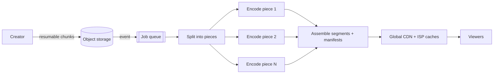

**In one line:** uploads go in chunks straight to storage, get split and transcoded in parallel into many small segments at several qualities, and are served from caches close to viewers, so no single machine ever handles a whole video or a whole audience.

> [!REAL] A factory assembly line
> The upload is cut into pieces, and many workers process the pieces at the same time, like an assembly line, instead of one worker building the whole car.

## The flow

## The ideas that make it work

1. **Chunked, resumable uploads.** A dropped connection only costs one chunk. The bytes go directly to storage, not through web servers.
2. **Parallel transcoding.** A 2-hour video is cut into short pieces that hundreds of workers encode at once, then stitched. Processing time depends on piece length, not video length.
3. **Many renditions.** Each video becomes several resolutions and codecs, so phones on 3G and TVs on fibre both play smoothly.
4. **Segments + adaptive bitrate.** Videos are stored as 2–6 second segments listed in a manifest; players switch quality segment by segment as bandwidth changes.
5. **Caching near viewers.** Segments never change, so CDNs and caches inside internet providers keep popular ones close to users. Most views never reach the origin.
6. **Effort follows popularity.** New and long-tail videos get fast, cheap encodes; videos that become popular are re-encoded with heavier, more efficient settings, because bandwidth saved × millions of views pays for it.
7. **Asynchronous everything else.** Thumbnails, captions, copyright matching and view counting happen in separate pipelines, so the upload and play paths stay fast.

## What to say in an interview

> "Chunked resumable uploads to object storage; an event kicks off a DAG that splits the video and transcodes the pieces in parallel into multiple bitrates as short segments with HLS/DASH manifests; segments are immutable, so they're cached aggressively on a multi-tier CDN; encoding effort scales with popularity; counts and analytics flow through streams."

Deep version: [Design a Video Streaming Platform](#/l/10-hld-case-studies/video-streaming).
