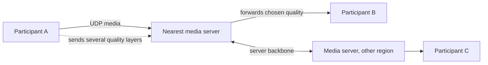

**In one line:** real-time media travels over UDP, where a late packet is simply skipped rather than retransmitted; the system adds a little redundancy, adapts the video quality to the network, smooths jitter with a short buffer, and routes media through nearby servers that forward (not re-encode) each stream.

## Why not TCP?

TCP retransmits every lost packet and holds everything after it until the gap is filled. For a live call, a packet that arrives 300 ms late is useless: the moment has passed. So calls use UDP and handle loss smartly instead.

## The ideas that make it work

1. **UDP + RTP.** Media packets are timestamped and sequenced so the receiver knows what's missing and when to play what.
2. **Forward error correction (FEC).** Extra recovery data is sent along with the media so a lost packet can be rebuilt without asking for it again. More redundancy when loss is high.
3. **Selective retransmission.** For video, a quick resend request (NACK) is used only if it can still arrive in time; otherwise move on.
4. **Jitter buffer.** Packets arrive unevenly; a short, adaptive buffer reorders and smooths them before playback, trading a few tens of milliseconds of delay for smooth audio.
5. **Packet-loss concealment.** For audio, the codec fills tiny gaps with plausible sound so you hear a smooth voice instead of clicks.
6. **Adaptive bitrate.** Congestion control watches loss and delay and lowers resolution or frame rate before the network chokes. Audio is protected first; video degrades gracefully.
7. **Simulcast / scalable video.** Each sender uploads a few quality layers; the **SFU** (selective forwarding unit) sends each receiver the layer their connection can handle, without decoding or re-encoding. That's cheap and scales to large meetings.
8. **Nearby media servers.** Users connect to the closest data centre; servers relay between regions over well-provisioned backbones. Fallback to TCP/TLS only when UDP is blocked.

## What to say in an interview

> "Media goes over UDP with RTP, protected by FEC and selective NACKs, smoothed by an adaptive jitter buffer, with loss concealment for audio. Congestion control adapts bitrate, and senders use simulcast so an SFU near each user forwards the right quality layer to each receiver without transcoding."

Related: [Networking Fundamentals](#/l/06-networking/fundamentals).
