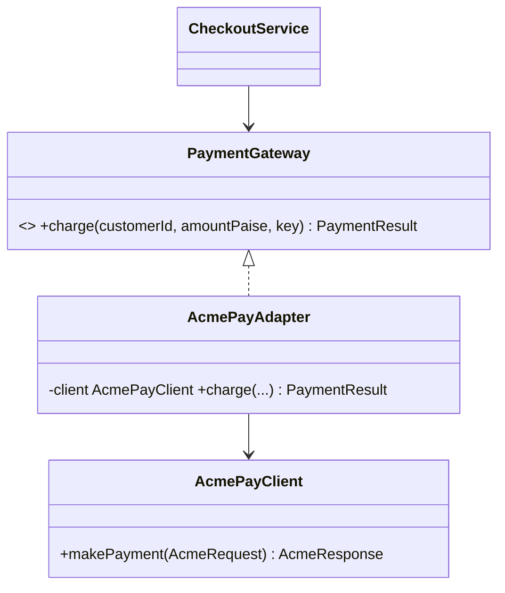

**Intent:** let classes with **incompatible interfaces** work together by wrapping one of them in an object that translates calls.

**Family:** structural. Also called a *wrapper*.

## The problem

Your checkout code depends on your own interface:

```java
interface PaymentGateway {
    PaymentResult charge(String customerId, long amountPaise, String idempotencyKey);
}
```

You integrate a third-party SDK whose API looks completely different and which you can't change:

```java
class AcmePayClient {                     // vendor code
    AcmeResponse makePayment(AcmeRequest req) { ... }   // amounts in rupees as BigDecimal, different fields
}
```

You don't want vendor types leaking all over your code.

> [!REAL] A travel plug adapter
> Your Indian charger doesn't fit a UK socket. The adapter changes the shape without changing the charger or the wall. In code, an adapter makes an old or third-party API look like the interface you expect.

## Object adapter (composition): the usual choice



```java
class AcmePayAdapter implements PaymentGateway {
    private final AcmePayClient client;
    AcmePayAdapter(AcmePayClient client) { this.client = client; }

    @Override
    public PaymentResult charge(String customerId, long amountPaise, String key) {
        AcmeRequest req = new AcmeRequest();
        req.setCustomerRef(customerId);
        req.setAmount(BigDecimal.valueOf(amountPaise, 2));    // paise → rupees
        req.setRequestId(key);                                // map idempotency key
        try {
            AcmeResponse res = client.makePayment(req);
            return res.isApproved()
                ? PaymentResult.success(res.getTxnId())
                : PaymentResult.declined(res.getReasonCode());
        } catch (AcmeTimeoutException e) {
            return PaymentResult.unknown();                    // translate vendor errors too
        }
    }
}
```

The adapter translates **method names, parameters, units, response types and exceptions**. Swapping vendors means writing another adapter; `CheckoutService` never changes.

## Class adapter (inheritance)

The adapter extends the adaptee and implements the target interface. Possible only when the adaptee isn't final and you need just one adaptee; Java's single inheritance makes the object adapter far more common.

## Two-way and default adapters

- A **two-way adapter** implements both interfaces so either side can use it.
- "Adapter" classes with empty default methods (like old Swing `MouseAdapter`) are a different, older idiom: convenience base classes, now mostly replaced by default methods in interfaces.

## Where you've seen it

- `Arrays.asList(array)`: adapts an array to the `List` interface.
- `InputStreamReader`: adapts a byte `InputStream` to a character `Reader`.
- `Collections.enumeration(...)` / `Collections.list(...)`: between legacy `Enumeration` and collections.
- Spring MVC's `HandlerAdapter`: lets the dispatcher call very different kinds of handlers uniformly.
- In system design: an **anti-corruption layer** in front of a legacy system is the adapter idea at service level.

## Adapter vs similar patterns

| Pattern | Purpose |
|---|---|
| **Adapter** | Make an existing interface fit the one clients expect |
| **Facade** | Provide a simpler interface to a whole subsystem |
| **Decorator** | Keep the same interface, add behaviour |
| **Proxy** | Keep the same interface, control access |
| **Bridge** | Designed up front to let abstraction and implementation vary independently |

> [!INTERVIEW] Say what gets translated
> "Each payment provider gets an adapter implementing our `PaymentGateway` interface. The adapter converts paise to the provider's units, maps our idempotency key to their request ID, and turns their timeout exception into our `UNKNOWN` result, so the rest of the system never sees vendor types."

## Key takeaways

- Adapter wraps an incompatible class to match the interface your code expects.
- Prefer object adapters (composition) over class adapters (inheritance).
- Translate everything at the boundary: names, units, data types, errors.
- It's the pattern behind clean third-party integrations and anti-corruption layers.
