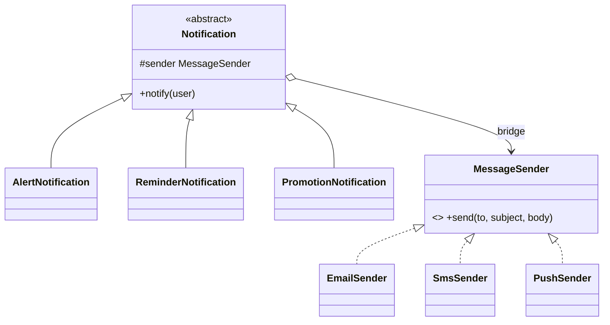

**Intent:** split a class that varies in **two independent dimensions** into two hierarchies, an *abstraction* and an *implementation*, connected by composition, so each can grow without multiplying classes.

**Family:** structural.

## The problem: class explosion

You send notifications of several **types** (alert, reminder, promotion) over several **channels** (email, SMS, push). With inheritance alone:

```text
EmailAlert, SmsAlert, PushAlert,
EmailReminder, SmsReminder, PushReminder,
EmailPromotion, SmsPromotion, PushPromotion   → 3 × 3 = 9 classes
```

Add WhatsApp and a new "security" type, and it becomes 4 × 4 = 16. Every combination is a class.

> [!REAL] Remotes and TVs
> Any remote (basic, advanced) can work with any TV brand (Sony, Samsung). You don't build a separate remote for every combination; the remote and the TV are joined by a common protocol.

## The bridge

Separate **what** the notification is (abstraction) from **how** it is delivered (implementation), and let the abstraction hold a reference to an implementation.



```java
// Implementation side
interface MessageSender { void send(String to, String subject, String body); }
class EmailSender implements MessageSender { public void send(String to, String s, String b) { /* SMTP */ } }
class SmsSender   implements MessageSender { public void send(String to, String s, String b) { /* SMS API, ignore subject */ } }

// Abstraction side
abstract class Notification {
    protected final MessageSender sender;          // the bridge
    protected Notification(MessageSender sender) { this.sender = sender; }
    abstract void notify(User user);
}
class AlertNotification extends Notification {
    AlertNotification(MessageSender s) { super(s); }
    void notify(User u) { sender.send(u.contact(), "Security alert", "New login from " + u.lastDevice()); }
}
class ReminderNotification extends Notification {
    ReminderNotification(MessageSender s) { super(s); }
    void notify(User u) { sender.send(u.contact(), "Reminder", "Your cart is waiting"); }
}

new AlertNotification(new SmsSender()).notify(user);
new ReminderNotification(new EmailSender()).notify(user);
```

Now it's 3 + 3 classes instead of 3 × 3, and either side can grow independently: a new channel is one class; a new notification type is one class.

## Bridge vs Strategy vs Adapter

- **Strategy** looks similar (an object holds an interchangeable behaviour). The difference is intent: Bridge is a **structural split of two dimensions designed up front**, often with both sides having hierarchies; Strategy swaps an **algorithm**.
- **Adapter** retrofits an incompatible interface after the fact; Bridge is designed from the start so the two sides can vary.

## Where you've seen it

- **JDBC:** your code uses the `Connection`/`Statement` abstraction; database drivers provide the implementation. New databases and new application code evolve independently.
- **SLF4J and logging back ends:** the logging API is the abstraction; Logback/Log4j are implementations.
- GUI toolkits separating windows/shapes from platform-specific rendering.

## When to use it

- You can name **two independent reasons** a class varies (type × platform, shape × renderer, document × storage).
- You want to switch implementations at runtime or configure them per environment.
- You see a combinatorial explosion of subclasses.

> [!INTERVIEW] Spot the two dimensions
> "Notification *type* and delivery *channel* vary independently. With inheritance that's N×M classes; with a bridge the notification holds a `MessageSender`, so it's N+M and we can add WhatsApp without touching any notification type."

## Key takeaways

- Bridge splits two independent dimensions into separate hierarchies joined by composition.
- It turns N×M subclasses into N+M classes.
- The abstraction delegates the "how" to an implementation object.
- JDBC and logging facades are everyday examples.
