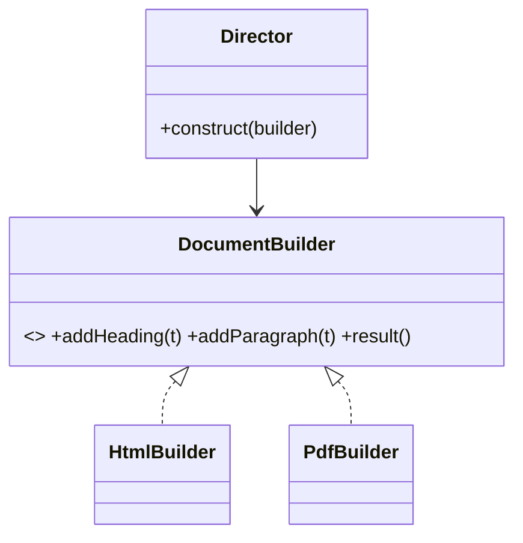

**Intent:** construct a complex object **step by step**, keeping the final object readable to create, valid and (usually) immutable.

**Family:** creational.

## The problem: telescoping constructors

```java
new Pizza("large", true, false, true, false, true, "thin", 2);   // what does each boolean mean?
```

Many parameters, many of them optional, lead to unreadable calls, constructor overloads for every combination, or mutable objects filled by setters (which can be observed half-built and can't be immutable).

> [!REAL] Customising a Subway sandwich
> Bread, cheese, veggies, sauces, toasted or not: you add one choice at a time and say "done" at the end. A builder sets options step by step instead of a constructor with 12 arguments.

## The builder

```java
public final class HttpRequest {
    private final String url;
    private final String method;
    private final Map<String, String> headers;
    private final String body;
    private final Duration timeout;

    private HttpRequest(Builder b) {
        this.url = b.url;
        this.method = b.method;
        this.headers = Map.copyOf(b.headers);
        this.body = b.body;
        this.timeout = b.timeout;
    }

    public static Builder newBuilder(String url) { return new Builder(url); }

    public static final class Builder {
        private final String url;                       // required
        private String method = "GET";                  // defaults for optional fields
        private final Map<String, String> headers = new HashMap<>();
        private String body;
        private Duration timeout = Duration.ofSeconds(10);

        private Builder(String url) { this.url = Objects.requireNonNull(url); }

        public Builder method(String m)              { this.method = m; return this; }
        public Builder header(String k, String v)    { headers.put(k, v); return this; }
        public Builder body(String b)                { this.body = b; return this; }
        public Builder timeout(Duration t)           { this.timeout = t; return this; }

        public HttpRequest build() {
            if (body != null && method.equals("GET"))
                throw new IllegalStateException("GET requests cannot have a body");
            return new HttpRequest(this);                // validate once, then create
        }
    }
}

HttpRequest req = HttpRequest.newBuilder("https://api.example.com/orders")
        .method("POST")
        .header("Idempotency-Key", key)
        .body(json)
        .timeout(Duration.ofSeconds(3))
        .build();
```

## Why it's good

- **Readable call sites:** each value is named.
- **Required vs optional:** required values in the builder's constructor; optional ones with defaults.
- **Validation in one place:** `build()` checks cross-field rules before the object exists.
- **Immutability:** the product has only `final` fields and no setters, which makes it thread-safe and easy to reason about.

## The classic GoF form: Director + Builder

The original pattern also has a **Director** that knows a construction *sequence*, and different builders that produce different representations from the same steps (e.g. one sequence of "add heading, add paragraph" builds HTML or PDF). Less common in everyday Java, but worth knowing if asked.



## Where you've seen it

- `StringBuilder` (builds a string step by step).
- `java.net.http.HttpRequest.newBuilder()`, `Stream.builder()`, `Locale.Builder`.
- Lombok's `@Builder`, which generates exactly the code above.
- Test data builders (`anOrder().withItems(3).paid().build()`) that make tests readable.

## When not to use it

- Objects with two or three required fields: a constructor or a Java `record` is clearer.
- When most callers set everything anyway; a builder just adds ceremony.

> [!INTERVIEW] Mention validation and immutability
> "Order has many optional fields (coupon, gift message, delivery slot), so I'd use a builder: required fields in the builder constructor, defaults for the rest, and `build()` validates rules like 'gift message needs a gift wrap', producing an immutable `Order`."

## Key takeaways

- Builder replaces long, confusing constructors with named, chainable steps.
- Required fields in the builder's constructor; defaults for optional ones; validation in `build()`.
- Produces immutable objects; Director + Builder separates construction steps from representation.
- Skip it for small objects; records or constructors are simpler.
