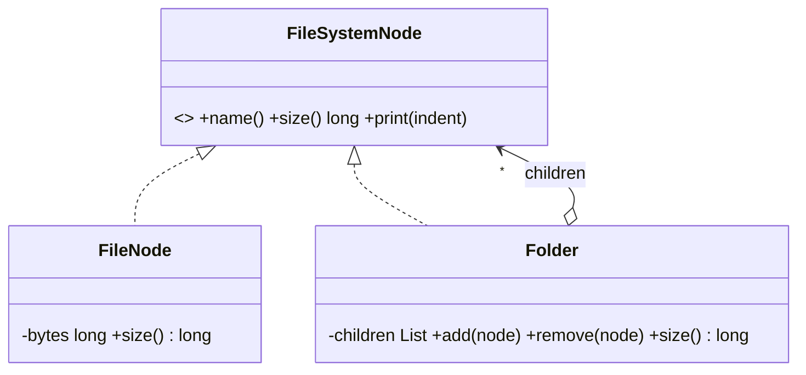

**Intent:** compose objects into **tree structures** and let clients treat individual objects (leaves) and groups (composites) **the same way**.

**Family:** structural.

## The problem

A file system has files and folders; folders contain files and other folders. To compute total size, code would otherwise check "is this a file or a folder?" at every level. Same for org charts (employees and teams), menus (items and submenus), UI layouts (widgets and panels), and orders (products and bundles).

> [!REAL] Folders inside folders
> A folder can hold files and other folders, and "size" works the same on both: a file returns its size, a folder adds up its children's sizes.

## Structure



## Java example

```java
interface FileSystemNode {
    String name();
    long size();
    void print(String indent);
}

record FileNode(String name, long bytes) implements FileSystemNode {
    public long size() { return bytes; }
    public void print(String indent) { System.out.println(indent + name + " (" + bytes + " B)"); }
}

final class Folder implements FileSystemNode {
    private final String name;
    private final List<FileSystemNode> children = new ArrayList<>();
    Folder(String name) { this.name = name; }

    Folder add(FileSystemNode n) { children.add(n); return this; }

    public String name() { return name; }

    public long size() {                                  // recursion over the tree
        return children.stream().mapToLong(FileSystemNode::size).sum();
    }

    public void print(String indent) {
        System.out.println(indent + name + "/");
        children.forEach(c -> c.print(indent + "  "));
    }
}

Folder root = new Folder("project")
    .add(new FileNode("README.md", 1_200))
    .add(new Folder("src")
        .add(new FileNode("App.java", 8_400))
        .add(new FileNode("Util.java", 2_100)));

root.size();    // 11,700, same call whether it's a file or a whole tree
```

The client calls `size()` without caring whether it holds a file or a folder of folders.

## Design choices

- **Where do `add`/`remove` live?**
  - Only on `Folder` (above): **type-safe**, since leaves can't have children, but clients sometimes need to know the type to add children.
  - On the common interface: **transparent** (all nodes look identical) but leaves must throw on `add`. Prefer type safety unless uniform treatment of child management is essential.
- **Parent references** make upward navigation easy (breadcrumbs, "move to parent") but must be kept in sync.
- **Caching** aggregated values (like size) speeds up big trees but needs invalidation on change.
- Watch for **cycles**: a folder must not contain itself.

## Where you've seen it

- Java AWT/Swing: `Container` holds `Component`s and is itself a `Component`.
- HTML DOM: elements contain elements and text nodes.
- Expression trees in parsers/calculators: `Add(Number(2), Multiply(Number(3), Number(4)))`.
- E-commerce bundles: a "combo" priced as the sum of its items, which can include other combos.
- Organisation charts and permission groups.

## Pairs well with

- **Iterator / Visitor** to walk the tree or add new operations without changing node classes.
- **Decorator**, which also uses recursive composition, but to add behaviour rather than to build part–whole trees.

> [!INTERVIEW] Recognise the tree
> Whenever the problem says "X can contain X" (folders in folders, categories in categories, bundles in bundles), mention Composite: "I'll model `MenuItem` and `Menu` with a common `MenuComponent` interface so pricing and rendering work recursively."

## Key takeaways

- Composite builds trees where leaves and containers share an interface.
- Operations like `size()` or `price()` recurse naturally through the tree.
- Choose between type-safe (children only on composites) and transparent child management.
- Common in file systems, UI trees, menus, org charts and expression trees.
