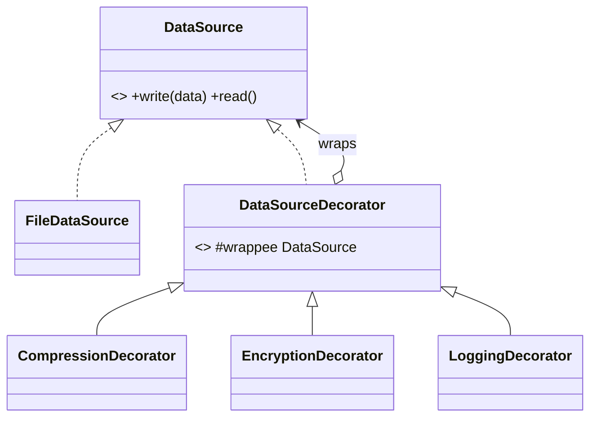

**Intent:** attach extra responsibilities to an object **dynamically**, by wrapping it in objects that share its interface, instead of creating a subclass for every combination.

**Family:** structural.

## The problem: subclass explosion

A data source can optionally compress, encrypt and log. Subclassing every combination gives `CompressedEncryptedLoggedFileDataSource` and friends: 2³ = 8 classes for 3 features, and you can't change combinations at runtime.

> [!REAL] Toppings on a pizza
> Start with a base pizza and wrap it with cheese, then olives, then jalapeños. Each topping adds to the price and the description without a new class for every combination.

## The decorator

Each decorator implements the same interface, holds the wrapped object, and adds behaviour before/after delegating.



```java
interface DataSource {
    void write(byte[] data);
    byte[] read();
}

class FileDataSource implements DataSource {
    private final Path path;
    FileDataSource(Path path) { this.path = path; }
    public void write(byte[] data) { /* Files.write(path, data) */ }
    public byte[] read() { /* return Files.readAllBytes(path) */ return new byte[0]; }
}

abstract class DataSourceDecorator implements DataSource {
    protected final DataSource wrappee;
    DataSourceDecorator(DataSource wrappee) { this.wrappee = wrappee; }
    public void write(byte[] data) { wrappee.write(data); }
    public byte[] read() { return wrappee.read(); }
}

class CompressionDecorator extends DataSourceDecorator {
    CompressionDecorator(DataSource d) { super(d); }
    @Override public void write(byte[] data) { super.write(compress(data)); }
    @Override public byte[] read() { return decompress(super.read()); }
    private byte[] compress(byte[] d) { /* gzip */ return d; }
    private byte[] decompress(byte[] d) { return d; }
}

class EncryptionDecorator extends DataSourceDecorator {
    private final SecretKey key;
    EncryptionDecorator(DataSource d, SecretKey key) { super(d); this.key = key; }
    @Override public void write(byte[] data) { super.write(encrypt(data)); }
    @Override public byte[] read() { return decrypt(super.read()); }
    private byte[] encrypt(byte[] d) { return d; }
    private byte[] decrypt(byte[] d) { return d; }
}

// Compose at runtime, in any order and combination:
DataSource ds = new EncryptionDecorator(
                    new CompressionDecorator(
                        new FileDataSource(Path.of("orders.bin"))), key);
ds.write(payload);   // compress → encrypt → file?  No: encrypt is outermost, so encrypt happens first
```

**Order matters.** The outermost decorator runs first on `write`. Here data is encrypted, then compressed, which compresses poorly, since encrypted bytes look random. Swap the wrappers so compression happens before encryption. Decorator chains make such ordering explicit and easy to change.

## Decorator vs inheritance vs proxy

| | Decorator | Subclassing | Proxy |
|---|---|---|---|
| When behaviour is added | Runtime, per object | Compile time, per class | Runtime |
| Combinations | Stack freely | One class per combination | Usually one wrapper |
| Purpose | **Add** responsibilities | Specialise | **Control access** (lazy, security, remote, caching) |

## Where you've seen it

- **Java I/O:** `new BufferedReader(new InputStreamReader(new FileInputStream(f)))`. Each layer adds buffering or decoding.
- `Collections.unmodifiableList(list)`, `Collections.synchronizedMap(map)`: same interface, added behaviour.
- **HTTP middleware / servlet filters** and Spring's `HandlerInterceptor`: wrap request handling with logging, auth, metrics.
- **Resilience wrappers:** a `RetryingPaymentGateway` wrapping a `CircuitBreakerPaymentGateway` wrapping the real gateway.

## Pitfalls

- Many small wrapper objects can make debugging harder (deep stack traces).
- Identity checks break: a decorated object isn't `==` the original.
- Keep decorators focused on one concern each.

> [!INTERVIEW] A practical example
> "Calls to the payment provider are wrapped in decorators implementing the same `PaymentGateway` interface: `MetricsGateway(RetryGateway(CircuitBreakerGateway(RazorpayGateway)))`. Each adds one concern, and we can change the stack per environment without touching the core client."

## Key takeaways

- Decorators wrap an object with the same interface and add behaviour before/after delegating.
- They replace combinatorial subclassing and allow runtime composition.
- Wrapping order matters.
- Java I/O streams and middleware chains are classic decorators.
