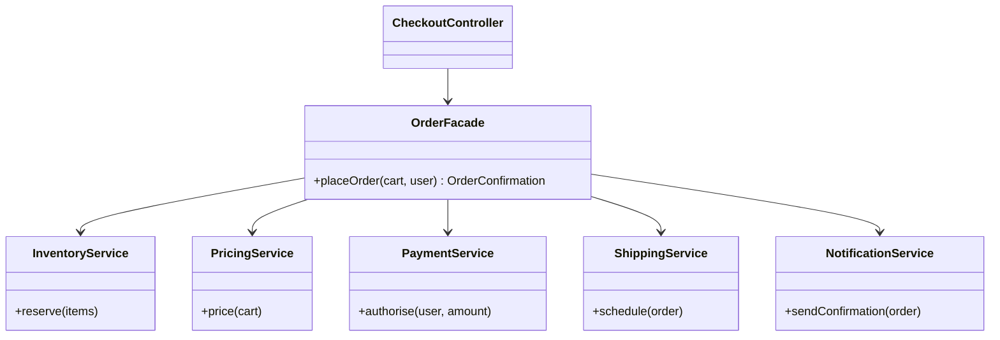

**Intent:** provide a **simple, unified interface** to a complex subsystem, so clients don't need to know how many parts it has or how they interact.

**Family:** structural.

## The problem

Placing an order touches inventory, pricing, payments, shipping and notifications, each with its own API and correct calling order. If every controller, batch job and admin tool calls them directly, the orchestration logic is duplicated and every client breaks when the subsystem changes.

> [!REAL] The "one-click" home theatre button
> One button dims the lights, turns on the projector, sets the amplifier and starts the film. A facade gives a simple front to a complicated set of subsystems.

## The facade



```java
public class OrderFacade {
    private final InventoryService inventory;
    private final PricingService pricing;
    private final PaymentService payments;
    private final ShippingService shipping;
    private final NotificationService notifications;

    public OrderFacade(InventoryService i, PricingService p, PaymentService pay,
                       ShippingService s, NotificationService n) {
        this.inventory = i; this.pricing = p; this.payments = pay; this.shipping = s; this.notifications = n;
    }

    public OrderConfirmation placeOrder(Cart cart, User user) {
        Price price = pricing.price(cart);
        Reservation r = inventory.reserve(cart.items());
        try {
            PaymentAuth auth = payments.authorise(user, price.total());
            Order order = Order.confirmed(cart, user, price, auth);
            shipping.schedule(order);
            notifications.sendConfirmation(order);
            return OrderConfirmation.of(order);
        } catch (PaymentDeclinedException e) {
            inventory.release(r);                          // the facade knows the cleanup rules
            throw e;
        }
    }
}

// Client code is now one line:
OrderConfirmation c = orderFacade.placeOrder(cart, user);
```

## What a facade is and isn't

- It **simplifies**, but doesn't hide the subsystem entirely: advanced clients can still use the underlying services directly.
- It **doesn't add new functionality**; it coordinates existing parts.
- It **reduces coupling**: clients depend on one class instead of five.
- It **shouldn't become a god object**: if it grows huge, split it into several facades by use case.

## Facade vs Adapter vs Mediator

| | Facade | Adapter | Mediator |
|---|---|---|---|
| Purpose | Simplify a complex subsystem | Make one interface fit another | Centralise communication between peers |
| Interface | New, simpler one | The one clients already expect | Peers talk through it |
| Typical scope | Many classes | One class | Many collaborating objects |

## Where you've seen it

- `javax.faces`/`Spring` "service" layers that coordinate repositories and clients.
- `JdbcTemplate` in Spring: hides connection handling, statements, result sets and exceptions behind simple methods.
- `java.net.http.HttpClient` (simple API over connections, TLS, HTTP/2 negotiation).
- **System design analogy:** an **API gateway** or **Backend-for-Frontend** is a facade over many microservices.

> [!INTERVIEW] Use it to keep controllers thin
> "Controllers call a `BookingFacade.book(...)`, which coordinates seat holds, payment and ticket issuance in the right order with the compensation logic. Controllers stay thin and the orchestration lives in one testable place."

## Key takeaways

- A facade offers one simple entry point to a complex set of classes or services.
- It centralises orchestration and reduces coupling, without preventing direct access.
- Keep it focused; split it when it grows too large.
- API gateways and BFFs are facades at the architecture level.
