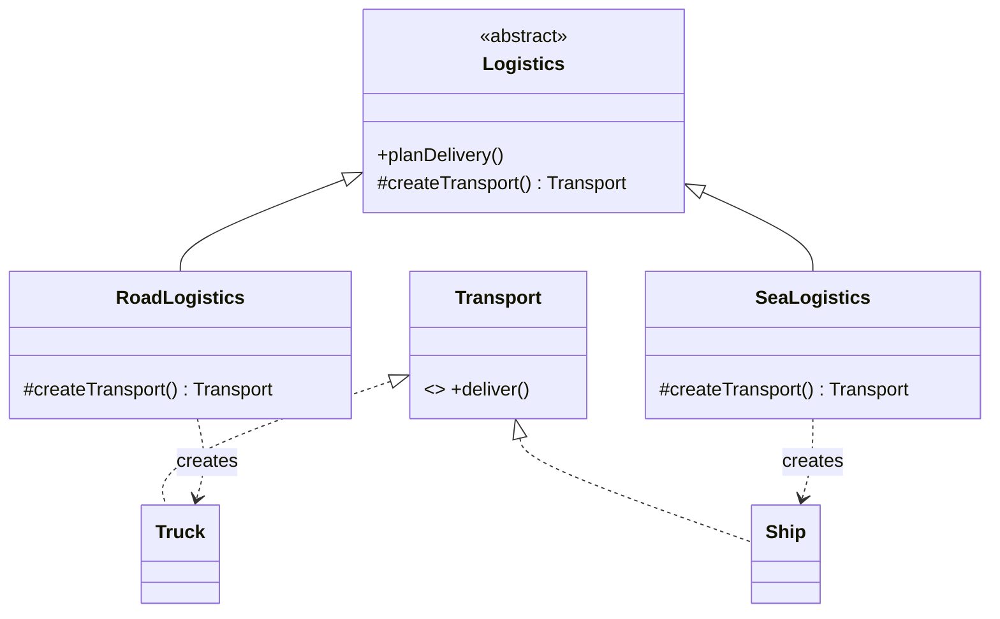

**Intent:** separate **creating** objects from **using** them, so calling code doesn't hard-code concrete classes.

**Family:** creational. There are three related variations, from simplest to most flexible.

## The problem

```java
Notification n;
if (channel.equals("EMAIL")) n = new EmailNotification(smtp);
else if (channel.equals("SMS")) n = new SmsNotification(smsClient);
else if (channel.equals("PUSH")) n = new PushNotification(fcm);
```

This `if/else` gets copied wherever notifications are created, and every new channel means editing all of them.

## 1. Simple Factory

One class (or static method) holds the creation logic.

```java
interface Notification { void send(String to, String msg); }

class NotificationFactory {
    private final Map<String, Supplier<Notification>> creators = Map.of(
        "EMAIL", EmailNotification::new,
        "SMS",   SmsNotification::new,
        "PUSH",  PushNotification::new
    );
    Notification create(String channel) {
        Supplier<Notification> s = creators.get(channel);
        if (s == null) throw new IllegalArgumentException("Unknown channel " + channel);
        return s.get();
    }
}
```

- **Pros:** creation in one place; callers depend only on `Notification`.
- **Cons:** adding a type still edits the factory (a registry map like above keeps that edit tiny). Not one of the original GoF patterns, but the most used in practice.

## 2. Factory Method

A base class defines a **method that subclasses override** to decide which object to create. The base class uses the product without knowing its concrete type.



```java
abstract class Logistics {
    void planDelivery(Order o) {
        Transport t = createTransport();       // the factory method
        t.deliver(o);
    }
    protected abstract Transport createTransport();
}
class RoadLogistics extends Logistics { protected Transport createTransport() { return new Truck(); } }
class SeaLogistics  extends Logistics { protected Transport createTransport() { return new Ship(); } }
```

- **Pros:** open/closed: new product = new subclass; the base algorithm is reused.
- **Cons:** a parallel class hierarchy for creators.
- **Seen in:** `Iterable.iterator()` (each collection decides its iterator), `Calendar.getInstance()` variations.

## 3. Abstract Factory

A factory interface that creates a **family of related objects** that must be used together.

```java
interface UiFactory {                 // one family per platform
    Button createButton();
    Checkbox createCheckbox();
}
class DarkThemeFactory implements UiFactory {
    public Button createButton()     { return new DarkButton(); }
    public Checkbox createCheckbox() { return new DarkCheckbox(); }
}
class LightThemeFactory implements UiFactory {
    public Button createButton()     { return new LightButton(); }
    public Checkbox createCheckbox() { return new LightCheckbox(); }
}

class SettingsScreen {
    SettingsScreen(UiFactory ui) {    // whole screen stays consistent
        ui.createButton(); ui.createCheckbox();
    }
}
```

Another real example: a `PaymentProviderFactory` that creates the matching `Authoriser`, `RefundClient` and `WebhookVerifier` for Stripe vs Razorpay, so you never mix one provider's client with another's verifier.

- **Pros:** guarantees consistent families; swap the whole family in one place.
- **Cons:** adding a **new kind** of product (e.g. `Slider`) changes every factory.

## Comparison

| | Simple Factory | Factory Method | Abstract Factory |
|---|---|---|---|
| Creates | One product, chosen by a parameter | One product, chosen by subclass | A family of related products |
| Mechanism | Conditional / registry | Inheritance (override) | Composition (inject a factory) |
| Add a new product type | Edit factory (or register) | New subclass | New factory class |
| Use when | Centralising `new` logic | A base algorithm needs a varying product | Products must match each other |

## In real Java code

- `List.of(...)`, `Optional.of(...)`, `Path.of(...)`: static factory methods with descriptive names, hiding the implementation class.
- Spring's `BeanFactory`/`FactoryBean` and `@Bean` methods are factories managed by the container.
- `DocumentBuilderFactory` (XML) is an abstract factory selecting an implementation.

> [!INTERVIEW] Pick the simplest one that fits
> "Notification channels are chosen at runtime from user preferences, so a small factory with a registry map is enough. I'd only reach for an abstract factory if each channel needed several matching collaborators, like a sender plus a template renderer plus a delivery tracker."

## Key takeaways

- Factories decouple creation from use, so callers depend on interfaces.
- Simple factory: one place with the `new` logic. Factory method: subclasses decide. Abstract factory: families of matching objects.
- Static factory methods (`of`, `from`, `valueOf`) are the everyday Java form.
