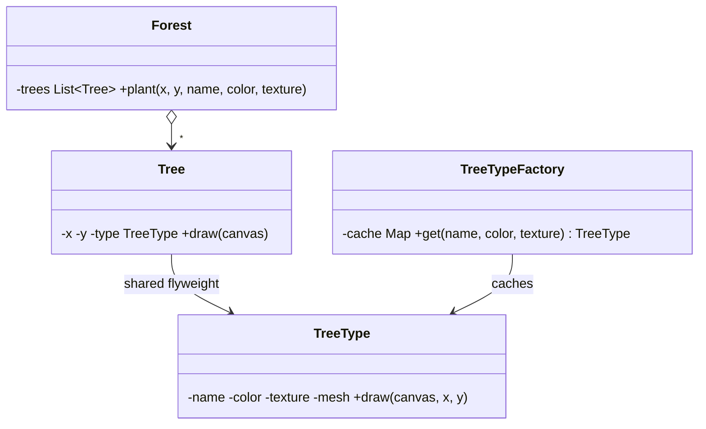

**Intent:** support **huge numbers of similar objects** efficiently by sharing the parts of their state that are the same, instead of storing a copy in every object.

**Family:** structural.

## The problem

A map app renders 1,000,000 trees. Each tree object stores its position plus its type data: species name, colour, a 200 KB texture and a 3D mesh. A million copies of the texture and mesh would need hundreds of gigabytes, while there are only 20 tree species.

> [!REAL] Trees in a video game forest
> A game forest has 100,000 trees, but only 5 tree models. Each tree stores only its position (extrinsic), sharing the heavy model and texture (intrinsic).

## Intrinsic vs extrinsic state

- **Intrinsic state:** shared, identical across many objects, and **immutable** (species name, texture, mesh). Stored once, in the flyweight.
- **Extrinsic state:** unique per use (x, y position, size, age). Stored by the client or passed in when needed.



## Java example

```java
// Flyweight: immutable, shared
record TreeType(String name, String color, byte[] texture) {
    void draw(Canvas c, int x, int y) { /* draw using shared texture at (x, y) */ }
}

// Factory guarantees sharing
final class TreeTypeFactory {
    private static final Map<String, TreeType> CACHE = new ConcurrentHashMap<>();
    static TreeType get(String name, String color, byte[] texture) {
        return CACHE.computeIfAbsent(name + "|" + color, k -> new TreeType(name, color, texture));
    }
}

// Context object: tiny, holds extrinsic state + reference to the flyweight
record Tree(int x, int y, TreeType type) {
    void draw(Canvas c) { type.draw(c, x, y); }
}

class Forest {
    private final List<Tree> trees = new ArrayList<>();
    void plant(int x, int y, String name, String color, byte[] texture) {
        trees.add(new Tree(x, y, TreeTypeFactory.get(name, color, texture)));
    }
}
```

Memory now ≈ 20 shared `TreeType`s + 1,000,000 small `Tree` records (two ints and a reference each), down from gigabytes to tens of megabytes.

## Rules for flyweights

- **Flyweights must be immutable**: they're shared, so changing one would change every user.
- **Use a factory/cache** so identical intrinsic states map to one instance.
- Worth it only when there are **many** objects and the shared part is **large** relative to the unique part. Otherwise it's needless complexity.
- Thread safety: shared immutable objects are naturally thread-safe; make the factory's cache concurrent.

## Where you've seen it

- **`Integer.valueOf(n)`** caches values from −128 to 127; `Boolean.valueOf`, `Character.valueOf` similarly reuse instances.
- **String interning / the string pool**: identical string literals share one object.
- **Text editors:** glyph objects for each character/font combination are shared; the document stores positions.
- **Game engines:** particle systems, tiles, sprites.
- **Database/connection pools** share a different kind of resource but follow a similar "don't create a new one for each use" spirit (they're object pools, not flyweights strictly, since pooled objects are reused one at a time, not shared simultaneously).

## Flyweight vs similar ideas

| | Flyweight | Object pool | Singleton | Caching |
|---|---|---|---|---|
| Shared simultaneously? | Yes, by many | No, one borrower at a time | Yes, one instance only | Yes |
| State | Immutable intrinsic | Mutable, reset on return | Any | Any |
| Purpose | Save memory across many similar objects | Avoid costly creation | One instance | Avoid recomputation |

> [!INTERVIEW] Name intrinsic vs extrinsic
> "In a document editor with millions of characters, each character's font, size and glyph are intrinsic and shared through a flyweight factory; position and the character's index in the text are extrinsic and stored per occurrence."

## Key takeaways

- Flyweight shares immutable intrinsic state across many objects; extrinsic state stays outside.
- A factory ensures one flyweight per distinct intrinsic state.
- Big memory savings when objects are numerous and the shared part is large.
- `Integer.valueOf` caching and string interning are everyday examples.
