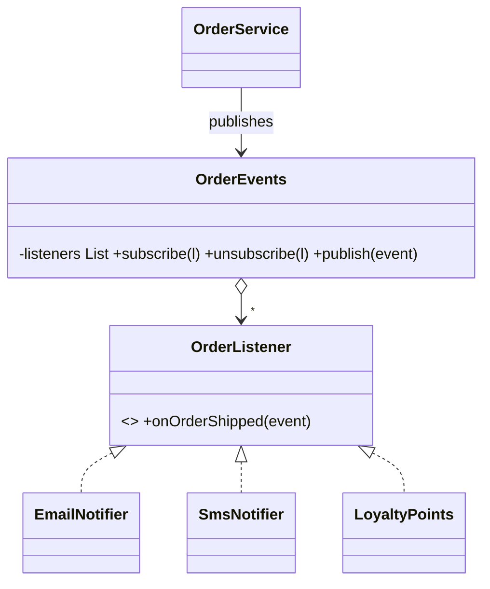

**Intent:** when one object (the **subject**) changes, automatically notify all the objects that depend on it (the **observers**), without the subject knowing who they are.

**Family:** behavioural. Also called publish–subscribe at the object level.

## The problem

When an order ships, the email service, the SMS service, the analytics module and the loyalty-points module all need to react. If `OrderService` calls each of them directly, it's coupled to all of them, and adding a new reaction means editing `OrderService`.

## Structure



## Java example

```java
record OrderShipped(String orderId, String userId, Instant at) { }

interface OrderListener { void onOrderShipped(OrderShipped e); }

class OrderEvents {
    private final List<OrderListener> listeners = new CopyOnWriteArrayList<>();   // safe to iterate while modifying
    void subscribe(OrderListener l)   { listeners.add(l); }
    void unsubscribe(OrderListener l) { listeners.remove(l); }
    void publish(OrderShipped e) {
        for (OrderListener l : listeners) {
            try { l.onOrderShipped(e); }
            catch (RuntimeException ex) { /* log; one bad listener must not stop the others */ }
        }
    }
}

class OrderService {
    private final OrderEvents events;
    OrderService(OrderEvents events) { this.events = events; }
    void ship(Order o) {
        // ... update state ...
        events.publish(new OrderShipped(o.id(), o.userId(), Instant.now()));
    }
}

events.subscribe(e -> emailService.sendShipped(e.userId(), e.orderId()));
events.subscribe(e -> loyalty.award(e.userId(), 50));
```

Adding a new reaction is a new subscriber; `OrderService` is untouched.

## Push vs pull

- **Push:** the event carries the data observers need (above). Simple; risk of sending too much or too little.
- **Pull:** the notification says "something changed", and observers query the subject for what they need. Flexible; more calls.

## Things to get right

- **Error isolation:** one failing observer shouldn't break the others or the subject.
- **Synchronous vs asynchronous:** synchronous observers slow the subject down; long-running work should run asynchronously (executor, queue).
- **Ordering:** don't rely on notification order unless you define it.
- **Memory leaks:** observers that never unsubscribe keep objects alive (the "lapsed listener" problem), a classic in UI code. Unsubscribe on teardown or use weak references.
- **Thread safety** of the subscriber list (`CopyOnWriteArrayList` is ideal when reads vastly outnumber changes).
- **Re-entrancy:** an observer that triggers another change can cause cascades or infinite loops.

## In frameworks and at scale

- **Spring application events:** `ApplicationEventPublisher.publishEvent(...)` with `@EventListener` methods; `@TransactionalEventListener(phase = AFTER_COMMIT)` runs only after the transaction commits, so listeners never react to rolled-back changes.
- **Reactive streams** (Project Reactor, RxJava): observers with backpressure.
- **UI frameworks:** event listeners, data binding.
- **Distributed systems:** the same idea across services becomes a **message broker** with publish/subscribe topics (Kafka, SNS). Observers become independent services, with durability and retries. See [Message Queue Patterns](#/l/08-distributed/message-queues).

> [!INTERVIEW] In-process vs distributed
> "Inside the order service, shipping publishes a domain event and in-process listeners update the order timeline. For other services (email, loyalty, analytics), the same event is written to the outbox and published to Kafka, the distributed version of Observer, with durability and independent scaling."

## Key takeaways

- Observer decouples a subject from the objects reacting to its changes.
- Subscribers can be added without modifying the subject (open/closed).
- Handle errors, async work, ordering, thread safety and unsubscription carefully.
- Spring events, reactive streams and message brokers are Observer at different scales.
