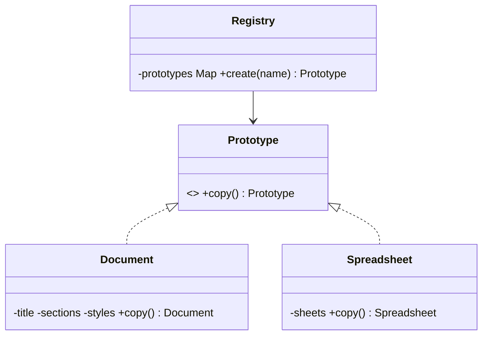

**Intent:** create new objects by **copying an existing, configured object** (the prototype) instead of building from scratch.

**Family:** creational.

## When it helps

- Building an object is **expensive** (loading data, parsing templates, heavy computation), and many similar objects are needed.
- You have a few **preconfigured variants** and want copies to tweak: "standard invoice template", "free-tier account settings", "default enemy in a game".
- Code must copy objects **without knowing their concrete classes**.

## Structure



## Java example with a copy constructor

```java
public class ReportTemplate {
    private final String title;
    private final List<Section> sections;
    private final Map<String, String> styles;

    public ReportTemplate(String title, List<Section> sections, Map<String, String> styles) {
        this.title = title;
        this.sections = sections;
        this.styles = styles;
    }

    // Deep copy: new collections, and copies of mutable elements.
    public ReportTemplate copy() {
        List<Section> secCopy = new ArrayList<>();
        for (Section s : sections) secCopy.add(s.copy());
        return new ReportTemplate(title, secCopy, new HashMap<>(styles));
    }

    public ReportTemplate withTitle(String newTitle) {
        ReportTemplate c = copy();
        return new ReportTemplate(newTitle, c.sections, c.styles);
    }
}

// Prototype registry
class TemplateRegistry {
    private final Map<String, ReportTemplate> prototypes = new HashMap<>();
    void register(String name, ReportTemplate t) { prototypes.put(name, t); }
    ReportTemplate create(String name) { return prototypes.get(name).copy(); }   // cheap copy, not rebuild
}
```

## Shallow vs deep copy (the main trap)

- **Shallow copy:** copies field values; for references, both objects point to the **same** inner objects. Changing a list in the copy changes the original too.
- **Deep copy:** recursively copies mutable inner objects so the copy is independent.

```java
ReportTemplate a = registry.create("monthly");
ReportTemplate b = a;              // not a copy at all, same object
ReportTemplate c = a.copy();       // independent (deep)
```

Immutable fields (`String`, records of immutables) can safely be shared; mutable ones (lists, maps, arrays, custom mutable objects) must be copied.

## About `Cloneable` and `clone()`

Java's built-in `Object.clone()` is widely considered broken: `Cloneable` has no `clone()` method, `clone()` is shallow by default, it bypasses constructors, and it doesn't play well with `final` fields. Prefer **copy constructors** or **copy/factory methods** (`copy()`, `withX(...)`).

## Where you've seen it

- Copy constructors like `new ArrayList<>(otherList)`, `new HashMap<>(otherMap)`.
- Spring's `prototype` bean scope (a new instance per request for the bean). Related in spirit, though the container creates fresh instances rather than cloning.
- JavaScript's prototype-based objects.
- Game engines spawning many copies of a configured entity.

> [!INTERVIEW] Shallow vs deep is the real question
> If asked about Prototype, explain the shallow/deep copy difference with an example of shared mutable state, then say you'd implement copying with copy constructors rather than `Cloneable`.

## Key takeaways

- Prototype creates objects by copying a configured instance, which is useful when construction is costly or variants are preconfigured.
- A registry of named prototypes plus `copy()` replaces repeated setup.
- Get deep copies right for mutable fields.
- Prefer copy constructors/methods over `Cloneable`.
