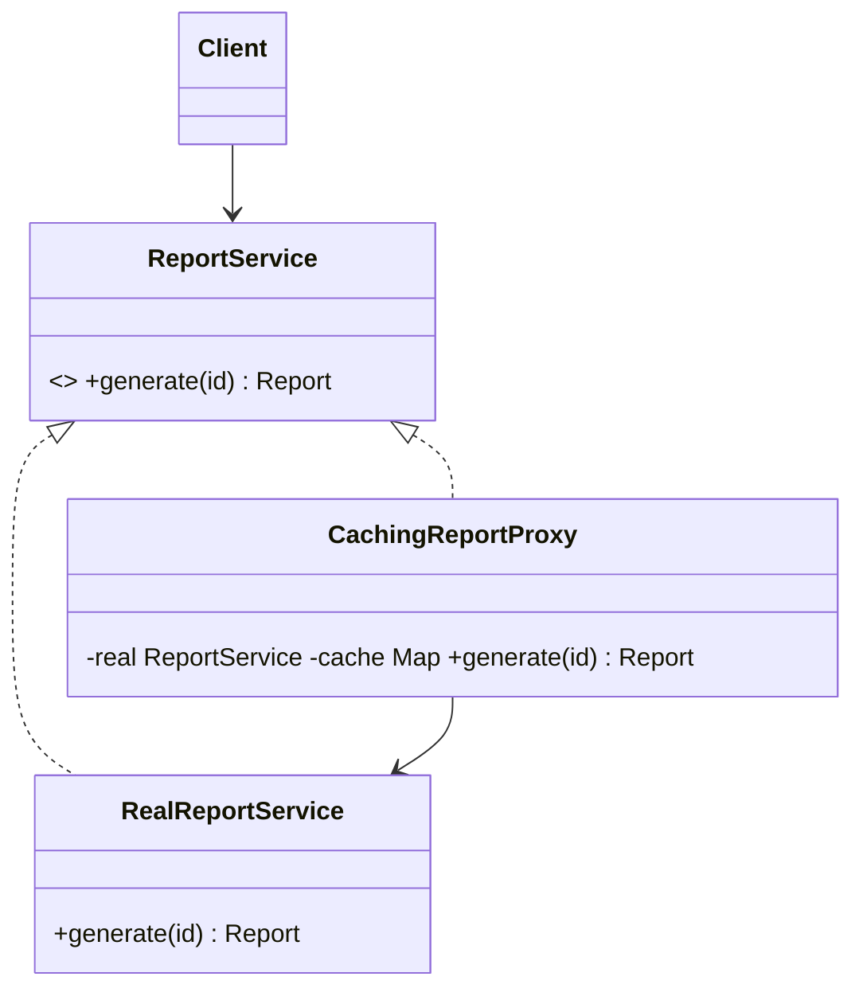

**Intent:** provide a **stand-in** object with the same interface as the real one, so you can **control access** to it: create it lazily, check permissions, cache results, call it remotely, or add logging, without the client knowing.

**Family:** structural.

## Kinds of proxy

| Kind | What it controls | Example |
|---|---|---|
| **Virtual proxy** | Expensive creation, so it's deferred until needed | Load a large image or entity only on first use |
| **Protection proxy** | Access rights | Only admins may call `delete()` |
| **Caching proxy** | Repeated expensive calls | Cache results of a slow pricing service |
| **Remote proxy** | Location: the real object lives elsewhere | gRPC/RMI stubs |
| **Logging / metrics proxy** | Observability | Time each call |
| **Smart reference** | Lifecycle | Reference counting, locking |

## Structure



## Java examples

### Caching + protection proxy

```java
interface ReportService { Report generate(String reportId, User user); }

class RealReportService implements ReportService {
    public Report generate(String id, User u) { /* expensive query, ~5 s */ return new Report(id); }
}

class SecureCachingReportProxy implements ReportService {
    private final ReportService real;
    private final Map<String, Report> cache = new ConcurrentHashMap<>();
    SecureCachingReportProxy(ReportService real) { this.real = real; }

    public Report generate(String id, User user) {
        if (!user.hasRole("ANALYST")) throw new AccessDeniedException(id);   // protection
        return cache.computeIfAbsent(id, k -> real.generate(k, user));       // caching
    }
}
```

### Virtual proxy (lazy loading)

```java
class LazyImage implements Image {
    private final Path path;
    private RealImage real;                       // not loaded yet
    LazyImage(Path path) { this.path = path; }
    public void display() {
        if (real == null) real = new RealImage(path);   // load from disk on first use
        real.display();
    }
}
```

### Dynamic proxy (JDK)

Java can generate proxies at runtime for any interface, the basis of many frameworks:

```java
@SuppressWarnings("unchecked")
static <T> T timed(T target, Class<T> iface) {
    return (T) Proxy.newProxyInstance(iface.getClassLoader(), new Class<?>[]{iface},
        (proxy, method, args) -> {
            long start = System.nanoTime();
            try { return method.invoke(target, args); }
            finally { System.out.printf("%s took %d µs%n", method.getName(), (System.nanoTime() - start) / 1000); }
        });
}
ReportService svc = timed(new RealReportService(), ReportService.class);
```

## Where you've seen it

- **Spring AOP:** `@Transactional`, `@Cacheable`, `@Async` and `@PreAuthorize` work by wrapping your bean in a proxy that starts transactions, checks caches or permissions, then calls your method. That's also why **self-invocation** (calling a `@Transactional` method from another method in the same class) bypasses the proxy and the annotation silently does nothing.
- **Hibernate/JPA lazy loading:** related entities are proxies that load from the database when first accessed (and throw `LazyInitializationException` if the session is closed).
- **gRPC/RMI client stubs:** remote proxies.
- **Infrastructure:** reverse proxies and API gateways apply the same idea between services. See [Forward vs Reverse Proxy](#/l/02-scalability/proxies).

## Proxy vs Decorator

Structurally identical (same interface, wraps an object). The difference is intent:
- **Decorator** adds features the client chooses to stack.
- **Proxy** controls access to the real subject, often managing its lifecycle, and is usually transparent to the client.

> [!INTERVIEW] The Spring connection
> Explaining that `@Transactional` works via a proxy, and therefore doesn't apply to internal self-calls or to private methods, is a frequent follow-up that shows you understand the pattern in practice.

## Key takeaways

- A proxy has the same interface as the real object and controls access to it.
- Variants: virtual (lazy), protection, caching, remote, logging, smart reference.
- JDK dynamic proxies and Spring AOP generate proxies at runtime.
- Same structure as Decorator, different intent: access control vs added behaviour.
