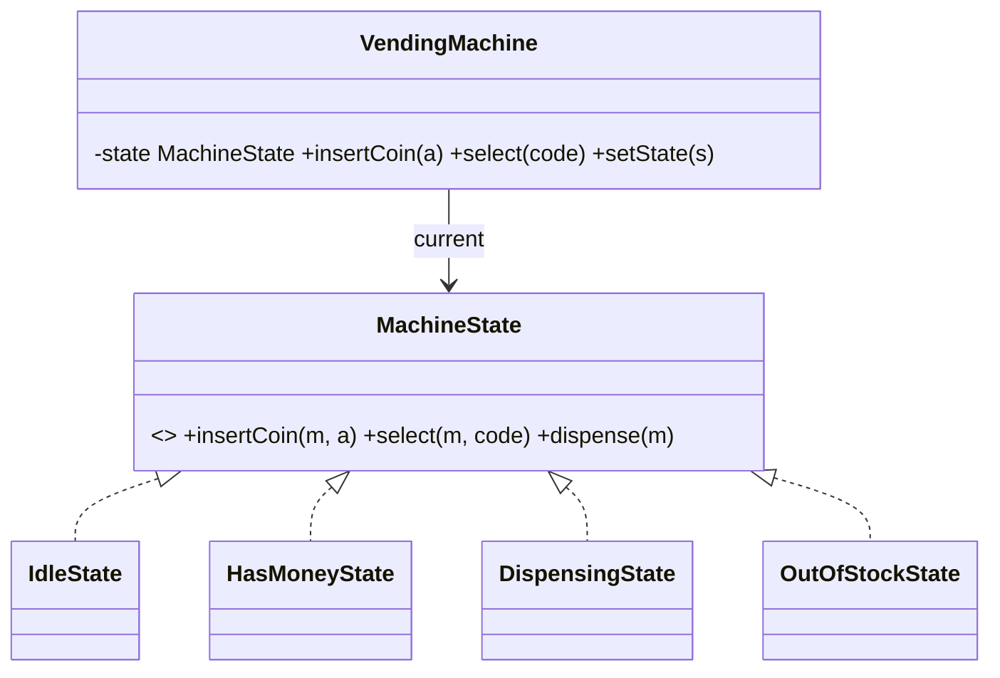
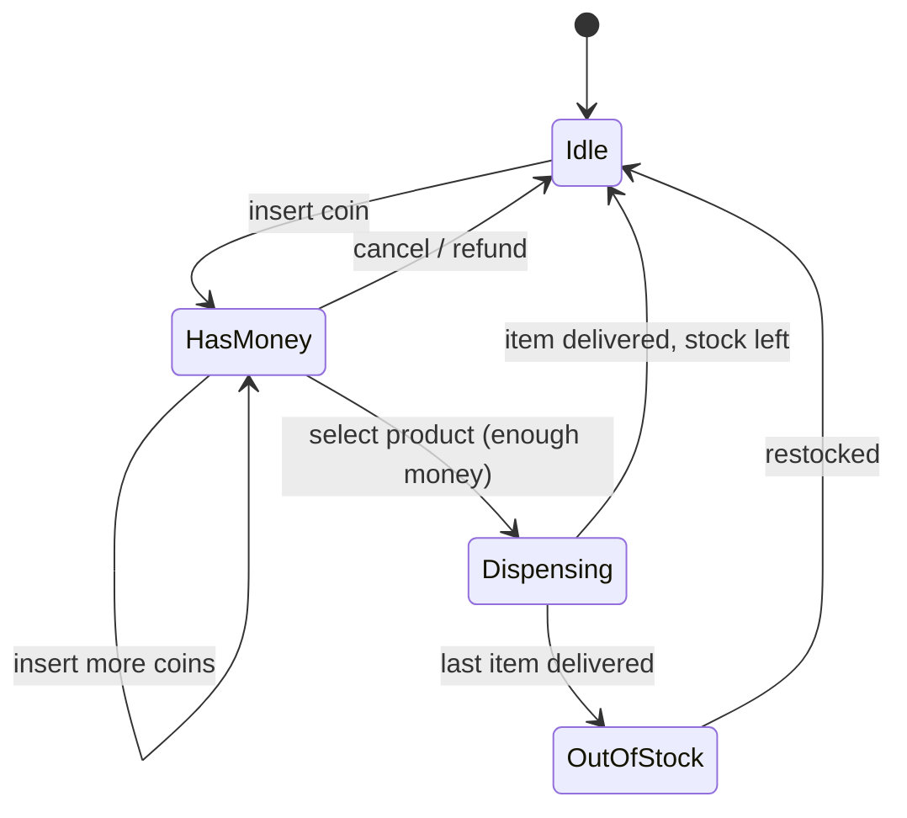

**Intent:** let an object **change its behaviour when its internal state changes**, by delegating to a separate state object for each state. From outside, it looks as if the object changed its class.

**Family:** behavioural. The go-to pattern for vending machines, order lifecycles, elevators and document workflows in LLD interviews.

## The problem

```java
void insertCoin(int amount) {
    if (state == IDLE) { balance += amount; state = HAS_MONEY; }
    else if (state == HAS_MONEY) { balance += amount; }
    else if (state == DISPENSING) { throw new IllegalStateException("Please wait"); }
    else if (state == OUT_OF_STOCK) { refund(amount); }
}
void selectProduct(String code) { /* another big if/else on state */ }
void dispense() { /* and another */ }
```

Every method repeats the same `if/else` on `state`. Adding a state ("maintenance mode") means editing every method, and invalid transitions are easy to miss.

> [!REAL] A traffic signal
> Red, green, yellow: the same "timer ticked" event does different things depending on the current state. Each state knows what comes next.

## Structure





## Java example

```java
interface MachineState {
    default void insertCoin(VendingMachine m, int amount) { throw new IllegalStateException("Cannot insert coin now"); }
    default void select(VendingMachine m, String code)    { throw new IllegalStateException("Cannot select now"); }
    default void cancel(VendingMachine m)                 { throw new IllegalStateException("Nothing to cancel"); }
}

class IdleState implements MachineState {
    public void insertCoin(VendingMachine m, int amount) {
        m.addBalance(amount);
        m.setState(new HasMoneyState());
    }
}

class HasMoneyState implements MachineState {
    public void insertCoin(VendingMachine m, int amount) { m.addBalance(amount); }
    public void select(VendingMachine m, String code) {
        Product p = m.inventory().get(code);
        if (p == null || p.stock() == 0) throw new IllegalArgumentException("Unavailable");
        if (m.balance() < p.price())     throw new IllegalStateException("Insert " + (p.price() - m.balance()) + " more");
        m.setState(new DispensingState());
        m.dispense(p);                                  // delivers item, returns change
        m.setState(m.inventory().isEmpty() ? new OutOfStockState() : new IdleState());
    }
    public void cancel(VendingMachine m) { m.refundBalance(); m.setState(new IdleState()); }
}

class DispensingState implements MachineState { }      // every action rejected while dispensing

class OutOfStockState implements MachineState {
    public void insertCoin(VendingMachine m, int amount) { m.refund(amount); }
}

class VendingMachine {
    private MachineState state = new IdleState();
    void setState(MachineState s) { this.state = s; }
    public void insertCoin(int amount) { state.insertCoin(this, amount); }   // delegate
    public void select(String code)    { state.select(this, code); }
    public void cancel()               { state.cancel(this); }
    // balance, inventory, dispense(), refund() ...
}
```

Each state class contains only the behaviour that makes sense **in that state**; invalid actions fall through to the default "not allowed". Adding a `MaintenanceState` is one new class plus the transitions into/out of it.

## Who decides the transitions?

- **States decide** (above): each state knows its successors. Easy to follow, but states know about each other.
- **Context decides** via a transition table: states only implement behaviour; a central table maps (state, event) → next state. Easier to visualise and validate, common in workflow engines.

Stateless state objects can be **shared singletons** (e.g. enum constants) instead of `new`-ing each time.

## Enum-based state machines

For simpler cases, an enum with behaviour per constant is compact:

```java
enum OrderStatus {
    PLACED    { OrderStatus next(Event e) { return e == Event.PAY ? PAID : e == Event.CANCEL ? CANCELLED : invalid(e); } },
    PAID      { OrderStatus next(Event e) { return e == Event.SHIP ? SHIPPED : e == Event.REFUND ? REFUNDED : invalid(e); } },
    SHIPPED   { OrderStatus next(Event e) { return e == Event.DELIVER ? DELIVERED : invalid(e); } },
    DELIVERED, CANCELLED, REFUNDED;
    OrderStatus next(Event e) { return invalid(e); }
    OrderStatus invalid(Event e) { throw new IllegalStateException(this + " cannot handle " + e); }
}
```

## State vs Strategy

Same structure (context delegates to an interchangeable object). The difference:
- **Strategy:** the client chooses the algorithm; strategies don't know about each other.
- **State:** the object moves between states itself, in response to events; states often trigger transitions.

## Where you've seen it

- Order, payment and booking lifecycles. See [Payment State Machines & Idempotency](#/l/11-payments-uploads/state-machine-idempotency).
- TCP connection states (LISTEN, SYN_SENT, ESTABLISHED…).
- UI components (enabled/disabled/loading), media players (playing/paused/stopped).
- Spring State Machine and workflow engines.

> [!INTERVIEW] Draw the state diagram first
> In an LLD round, sketch the states and transitions before writing classes. It exposes missing cases (what happens if the user cancels while dispensing?) and maps directly onto one class per state.

## Key takeaways

- State replaces repeated `if/else` on a status field with one class per state.
- Each state handles only valid actions; invalid ones are rejected in one place.
- Transitions can live in the states or in a central table; enums work for simple machines.
- Structurally like Strategy, but the object changes its own state in response to events.
