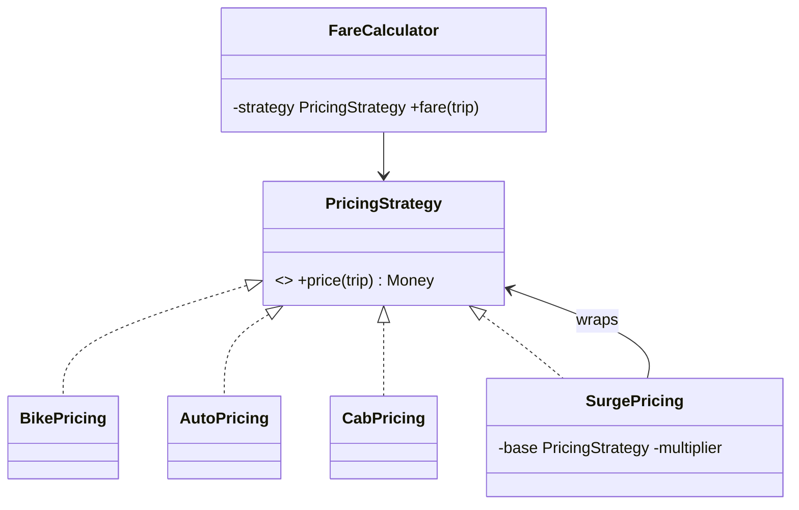

**Intent:** define a family of interchangeable algorithms, put each behind a common interface, and let the client choose one **at runtime**.

**Family:** behavioural. Probably the most useful pattern in LLD interviews.

## The problem

```java
double fare(Trip t) {
    switch (t.vehicleType()) {
        case BIKE:  return 20 + t.km() * 6;
        case AUTO:  return 30 + t.km() * 10;
        case CAB:   return 50 + t.km() * 14 + t.minutes() * 1;
        // every new vehicle or pricing rule edits this method
    }
    throw new IllegalArgumentException();
}
```

Pricing rules change often (surge, festivals, subscriptions), and the `switch` grows and gets duplicated.

## The strategy



```java
interface PricingStrategy { long priceInPaise(Trip trip); }

class BikePricing implements PricingStrategy {
    public long priceInPaise(Trip t) { return 2_000 + t.meters() * 6; }
}
class CabPricing implements PricingStrategy {
    public long priceInPaise(Trip t) { return 5_000 + t.meters() * 14 + t.seconds() * 2; }
}
class SurgePricing implements PricingStrategy {           // strategies can compose
    private final PricingStrategy base; private final double multiplier;
    SurgePricing(PricingStrategy base, double m) { this.base = base; this.multiplier = m; }
    public long priceInPaise(Trip t) { return Math.round(base.priceInPaise(t) * multiplier); }
}

class FareCalculator {
    private final Map<VehicleType, PricingStrategy> strategies;
    FareCalculator(Map<VehicleType, PricingStrategy> strategies) { this.strategies = strategies; }
    long fare(Trip t, double surge) {
        PricingStrategy s = strategies.get(t.vehicleType());
        return (surge > 1.0 ? new SurgePricing(s, surge) : s).priceInPaise(t);
    }
}
```

Adding a new vehicle = a new class registered in the map; `FareCalculator` never changes (open/closed).

## Lambdas make it lightweight

With a functional interface, small strategies don't even need classes:

```java
Map<VehicleType, PricingStrategy> strategies = Map.of(
    VehicleType.BIKE, t -> 2_000 + t.meters() * 6,
    VehicleType.AUTO, t -> 3_000 + t.meters() * 10
);
```

`Comparator` is the JDK's best-known strategy: `list.sort(Comparator.comparing(Order::total).reversed())`.

## Choosing the strategy

- By **configuration** (per tenant, per region).
- By **context** at runtime (vehicle type, payment method, user tier) via a map/registry or a factory.
- By **dependency injection**: in Spring, inject `List<PaymentStrategy>` or `Map<String, PaymentStrategy>` and pick by key.

## Strategy vs State vs Template Method

| | Strategy | State | Template Method |
|---|---|---|---|
| Who chooses the behaviour | The client/context, from outside | The object itself, as its state changes | Subclass, at compile time |
| Mechanism | Composition | Composition | Inheritance |
| Typical example | Pricing, sorting, payment method | Order lifecycle, vending machine | Report generation steps |

## Where you've seen it

- `Comparator`, `ThreadPoolExecutor`'s `RejectedExecutionHandler`, `java.util.function` lambdas passed to methods.
- Spring Security's authentication providers; Spring's `ResourceLoader` strategies.
- Load-balancing algorithms, retry/backoff policies, cache eviction policies (all pluggable strategies).

> [!INTERVIEW] Use it whenever the requirements say "can vary"
> "Parking fees differ for hourly, daily and weekend rates and may change, so `FeeStrategy` is an interface with one implementation per scheme, selected by the lot's configuration. New schemes don't touch `ParkingLot`."

## Key takeaways

- Strategy encapsulates interchangeable algorithms behind one interface, chosen at runtime.
- It replaces type-switching with polymorphism and keeps code open for extension.
- Lambdas and DI make strategies cheap to write and select.
- Different from State (self-transitioning) and Template Method (inheritance-based).
