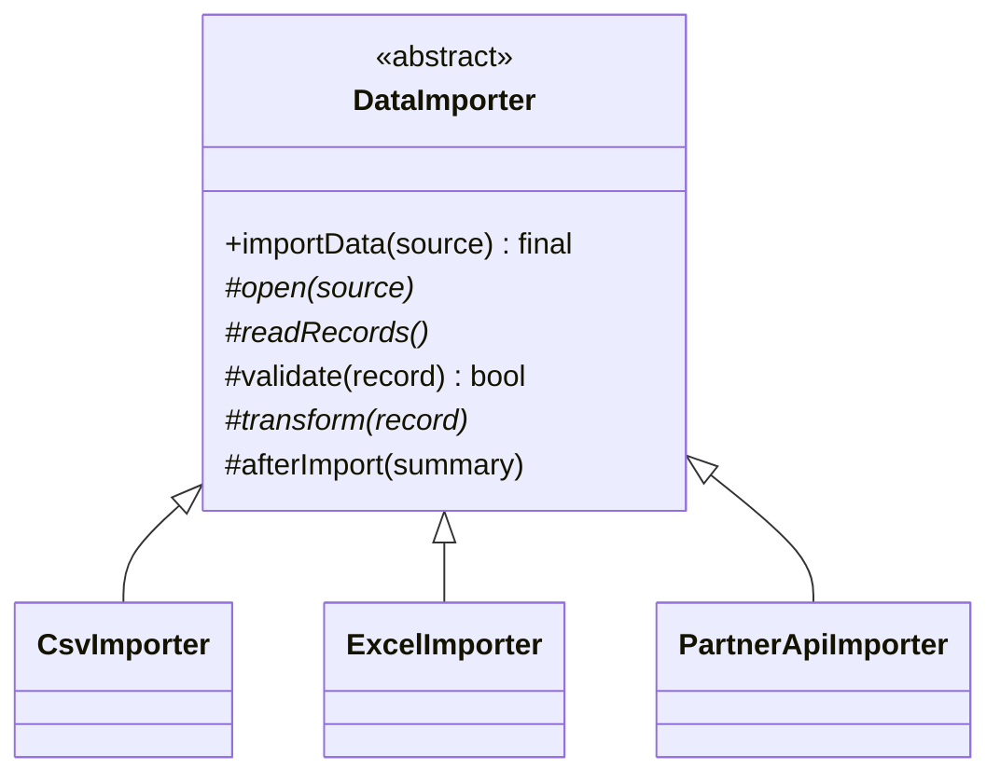

**Intent:** define the **skeleton of an algorithm** in a base class, and let subclasses fill in specific steps without changing the overall order.

**Family:** behavioural.

## The problem

Every data import follows the same steps: open the source, read records, validate, transform, save, report. Only some steps differ between CSV files, Excel sheets and a partner's API. Copy-pasting the whole flow into each importer duplicates the sequence, and a fix to the flow (say, adding an audit step) must be repeated everywhere.

## Structure



## Java example

```java
public abstract class DataImporter {

    // The template method: final, so subclasses can't change the order.
    public final ImportSummary importData(String source) {
        open(source);
        ImportSummary summary = new ImportSummary();
        try {
            for (RawRecord raw : readRecords()) {
                if (!validate(raw)) { summary.rejected(raw); continue; }
                repository.save(transform(raw));
                summary.imported();
            }
        } finally {
            close();
        }
        afterImport(summary);                     // hook
        return summary;
    }

    // Steps every subclass must provide
    protected abstract void open(String source);
    protected abstract Iterable<RawRecord> readRecords();
    protected abstract Customer transform(RawRecord raw);

    // Steps with a sensible default that subclasses may override
    protected boolean validate(RawRecord raw) { return raw.has("email"); }
    protected void close() { }
    protected void afterImport(ImportSummary s) { }   // hook: does nothing by default

    protected CustomerRepository repository;
}

public class CsvImporter extends DataImporter {
    private BufferedReader reader;
    protected void open(String path) { /* reader = Files.newBufferedReader(Path.of(path)) */ }
    protected Iterable<RawRecord> readRecords() { /* parse lines */ return List.of(); }
    protected Customer transform(RawRecord r) { return new Customer(r.get("email"), r.get("name")); }
    @Override protected void close() { /* reader.close() */ }
}

public class PartnerApiImporter extends DataImporter {
    protected void open(String endpoint) { /* authenticate */ }
    protected Iterable<RawRecord> readRecords() { /* page through API */ return List.of(); }
    protected Customer transform(RawRecord r) { return new Customer(r.get("mail"), r.get("fullName")); }
    @Override protected void afterImport(ImportSummary s) { /* notify partner of results */ }
}
```

## Three kinds of steps

1. **Abstract steps:** must be implemented (`open`, `readRecords`, `transform`).
2. **Default steps:** implemented in the base, overridable (`validate`).
3. **Hooks:** empty by default, optional extension points (`afterImport`).

Make the template method itself **`final`** so the algorithm's order stays fixed. This is the "Hollywood principle": *don't call us, we'll call you*. The base class calls the subclass's steps.

## Template Method vs Strategy

| | Template Method | Strategy |
|---|---|---|
| Mechanism | Inheritance | Composition |
| What varies | Individual steps of one algorithm | The whole algorithm |
| When chosen | Compile time (which subclass) | Runtime (which object) |
| Coupling | Subclass tied to base class | Loose |

Modern Java often prefers composition: pass the varying steps as strategies or lambdas into a single class. Template Method remains natural when steps share state and the skeleton is stable.

## Where you've seen it

- **`AbstractList`**, `AbstractMap`: implement a few methods (`get`, `size`) and inherit the rest.
- **`HttpServlet.service()`** calls `doGet`/`doPost` that you override.
- **Spring's `JdbcTemplate`, `RestTemplate`, `TransactionTemplate`**: fixed skeletons (open connection, execute, handle errors, release) with your code supplied as callbacks, a composition-flavoured variant.
- **JUnit lifecycle:** `@BeforeEach` → test → `@AfterEach`.

> [!INTERVIEW] Spot the fixed sequence
> "Every report follows fetch → aggregate → format → deliver; only fetch and format differ by report type. A `ReportGenerator` base class with a final `generate()` keeps the sequence and lets each report override its two steps."

## Key takeaways

- Template Method fixes an algorithm's sequence in a final base method and lets subclasses supply steps.
- Steps can be abstract, defaulted or optional hooks.
- It's inheritance-based; Strategy is the composition-based alternative.
- Frameworks use it heavily (servlets, abstract collections, Spring templates).
