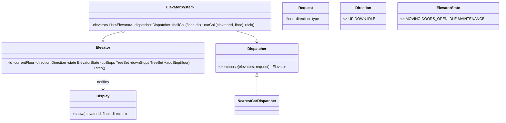

> [!REAL] The lift in your office building
> A lift going up keeps stopping at floors on its way up before turning around, like a bus finishing its route. That's the SCAN algorithm, and it's why the lift doesn't zig-zag between floors.
## Requirements

- A building has **N floors** and **M elevators**.
- **Hall calls:** a person on a floor presses UP or DOWN.
- **Car calls:** a person inside presses a destination floor.
- A **dispatcher** assigns each hall call to the best elevator.
- Each elevator serves requests efficiently (no zig-zagging), opens/closes doors, respects capacity, and can be put in maintenance.
- Display current floor and direction.

## Class diagram



## Scheduling inside one elevator: the SCAN (elevator) algorithm

Like a disk head: keep moving in the current direction, serving every stop on the way, until there are no more stops ahead; then reverse. Two sorted sets make this efficient:
- `upStops`: floors to stop at while going up (ascending).
- `downStops`: floors to stop at while going down (descending).

```java
enum Direction { UP, DOWN, IDLE }

class Elevator {
    private final int id;
    private int currentFloor = 0;
    private Direction direction = Direction.IDLE;
    private final TreeSet<Integer> upStops = new TreeSet<>();
    private final TreeSet<Integer> downStops = new TreeSet<>(Comparator.reverseOrder());
    private boolean inMaintenance;

    synchronized void addStop(int floor) {
        if (floor > currentFloor) upStops.add(floor);
        else if (floor < currentFloor) downStops.add(floor);
        else openDoors();                                   // already here
        if (direction == Direction.IDLE) direction = floor > currentFloor ? Direction.UP : Direction.DOWN;
    }

    /** Called once per simulation tick: move one floor or stop. */
    synchronized void step() {
        if (inMaintenance || direction == Direction.IDLE) return;

        if (direction == Direction.UP) {
            if (upStops.isEmpty()) { direction = downStops.isEmpty() ? Direction.IDLE : Direction.DOWN; return; }
            currentFloor++;
            if (upStops.remove(currentFloor)) openDoors();
        } else {
            if (downStops.isEmpty()) { direction = upStops.isEmpty() ? Direction.IDLE : Direction.UP; return; }
            currentFloor--;
            if (downStops.remove(currentFloor)) openDoors();
        }
    }

    /** Cost for the dispatcher: how far, and is the request on our way? */
    synchronized int costTo(int floor, Direction requested) {
        int distance = Math.abs(floor - currentFloor);
        if (direction == Direction.IDLE) return distance;
        boolean onTheWay = (direction == Direction.UP && requested == Direction.UP && floor >= currentFloor)
                        || (direction == Direction.DOWN && requested == Direction.DOWN && floor <= currentFloor);
        return onTheWay ? distance : distance + 2 * pendingSpan();   // penalise turning back
    }

    private int pendingSpan() {
        int hi = upStops.isEmpty() ? currentFloor : upStops.last();
        int lo = downStops.isEmpty() ? currentFloor : downStops.last();
        return hi - lo;
    }

    private void openDoors() { /* state = DOORS_OPEN, wait, close; notify displays */ }
}
```

## Dispatching across elevators (Strategy)

```java
interface Dispatcher { Elevator choose(List<Elevator> elevators, int floor, Direction dir); }

class NearestCarDispatcher implements Dispatcher {
    public Elevator choose(List<Elevator> elevators, int floor, Direction dir) {
        return elevators.stream()
                .filter(e -> !e.inMaintenance())
                .min(Comparator.comparingInt(e -> e.costTo(floor, dir)))
                .orElseThrow(() -> new IllegalStateException("No elevator available"));
    }
}

class ElevatorSystem {
    private final List<Elevator> elevators;
    private final Dispatcher dispatcher;

    void hallCall(int floor, Direction dir) { dispatcher.choose(elevators, floor, dir).addStop(floor); }
    void carCall(int elevatorId, int floor) { elevators.get(elevatorId).addStop(floor); }
    void tick() { elevators.forEach(Elevator::step); }   // driven by a scheduler thread
}
```

Other dispatch strategies: zoning (elevators serve floor ranges), destination dispatch (passengers enter their destination in the lobby and are grouped), energy-saving modes off-peak. They're all just new `Dispatcher` implementations.

## Design decisions

- **SCAN scheduling** avoids starvation and zig-zagging; two `TreeSet`s give O(log n) insert/remove.
- **Dispatcher as a strategy** isolates the policy that changes most.
- **State enum** for the car (MOVING, DOORS_OPEN, IDLE, MAINTENANCE) prevents moving with doors open.
- **Thread safety:** requests arrive from many buttons concurrently; elevator methods are synchronised (or requests go through a queue consumed by each elevator's control thread).
- **Observer** for displays and floor indicators.

## Extensions

- Capacity/weight limits: skip hall calls when full.
- Emergency mode (fire: return to ground floor, ignore calls).
- VIP/service elevators; express elevators skipping floors.
- Metrics: average wait time to tune dispatching.
