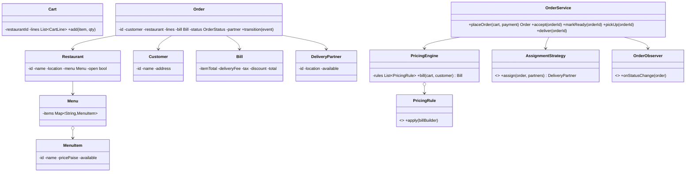
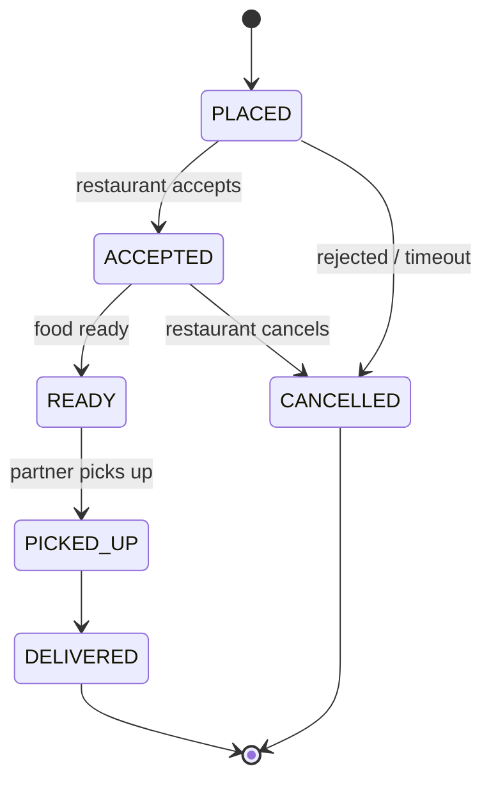

> [!REAL] One Swiggy order's journey
> Placed → accepted by the restaurant → being prepared → picked up → delivered. Each step is a state, and pricing rules (delivery fee, offers, taxes) chain together.
## Requirements (LLD scope)

- **Restaurants** have menus of **items** (price, availability).
- **Customers** build a cart from one restaurant, place an **order** and pay.
- Restaurants accept/reject orders and mark them ready.
- A **delivery partner** is assigned (nearest available), picks up and delivers.
- Order status updates are pushed to the customer, restaurant and partner.
- Pricing: item total + delivery fee + taxes − discounts (rules change often).

## Class diagram



## Order lifecycle (State)



```java
enum OrderStatus {
    PLACED, ACCEPTED, READY, PICKED_UP, DELIVERED, CANCELLED;

    private static final Map<OrderStatus, Set<OrderStatus>> NEXT = Map.of(
        PLACED,    Set.of(ACCEPTED, CANCELLED),
        ACCEPTED,  Set.of(READY, CANCELLED),
        READY,     Set.of(PICKED_UP),
        PICKED_UP, Set.of(DELIVERED));

    boolean canMoveTo(OrderStatus to) { return NEXT.getOrDefault(this, Set.of()).contains(to); }
}

class Order {
    private OrderStatus status = OrderStatus.PLACED;
    private final List<OrderObserver> observers;
    synchronized void moveTo(OrderStatus to) {
        if (!status.canMoveTo(to)) throw new IllegalStateException(status + " → " + to);
        status = to;
        observers.forEach(o -> o.onStatusChange(this));     // push to customer, restaurant, partner apps
    }
}
```

## Pricing as a chain of rules (Strategy / Chain)

```java
interface PricingRule { void apply(BillBuilder b, Cart cart, Customer c); }

class ItemTotalRule implements PricingRule {
    public void apply(BillBuilder b, Cart cart, Customer c) {
        b.itemTotal(cart.lines().stream().mapToLong(l -> l.item().pricePaise() * l.qty()).sum());
    }
}
class DistanceDeliveryFee implements PricingRule {
    public void apply(BillBuilder b, Cart cart, Customer c) {
        double km = geo.distanceKm(cart.restaurant().location(), c.address());
        b.deliveryFee(km <= 3 ? 2_000 : 2_000 + Math.round((km - 3) * 800));
    }
}
class FreeDeliveryForMembers implements PricingRule {
    public void apply(BillBuilder b, Cart cart, Customer c) { if (c.isMember()) b.deliveryFee(0); }
}
class GstRule implements PricingRule {
    public void apply(BillBuilder b, Cart cart, Customer c) { b.tax(Math.round(b.itemTotal() * 0.05)); }
}

class PricingEngine {
    private final List<PricingRule> rules;           // order matters; configured per city/campaign
    Bill bill(Cart cart, Customer c) {
        BillBuilder b = new BillBuilder();
        rules.forEach(r -> r.apply(b, cart, c));
        return b.build();
    }
}
```

New offers are new rules, configured without changing `OrderService`.

## Partner assignment (Strategy)

```java
interface AssignmentStrategy { Optional<DeliveryPartner> assign(Order o, List<DeliveryPartner> nearby); }

class NearestAvailable implements AssignmentStrategy {
    public Optional<DeliveryPartner> assign(Order o, List<DeliveryPartner> nearby) {
        return nearby.stream()
                .filter(DeliveryPartner::isAvailable)
                .sorted(Comparator.comparingDouble(p -> geo.distanceKm(p.location(), o.restaurant().location())))
                .filter(DeliveryPartner::tryReserve)        // atomic: available → assigned
                .findFirst();
    }
}
```

`tryReserve` uses an atomic compare-and-set, so two orders can't grab the same partner.

## Design decisions

- **Cart restricted to one restaurant**, which simplifies orders and delivery.
- **State machine** for the order with validated transitions; **observers** push updates to each app.
- **Pricing as composable rules**, changing per city/campaign.
- **Assignment strategy** pluggable (nearest, batching, fairness), with atomic partner reservation.
- **Payment** authorised on placement, captured on acceptance, voided on rejection (via a `PaymentProcessor` interface).

## Extensions

- Restaurant acceptance timeout → auto-cancel (scheduled task).
- Batching two orders to one partner.
- Ratings and reviews; live tracking (partner location observer).
- System-level design: [Lab: Food Delivery](#/l/13-design-it-yourself/food-delivery).
