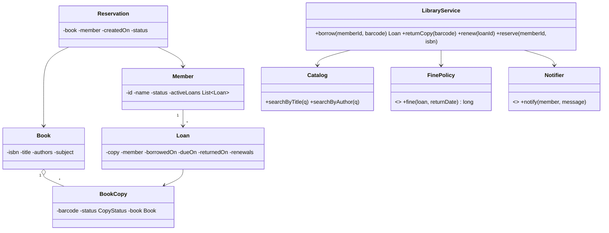

## Requirements

- The library holds **books** (title, author, ISBN) with one or more physical **copies** (book items, each with a barcode).
- **Members** can search the catalogue, borrow copies (max 5 at a time, 14-day loan), return them, renew once, and **reserve** a book when all copies are out.
- Overdue returns incur a **fine** per day.
- When a reserved book is returned, the next member in the reservation queue is **notified** and the copy is held for them for 3 days.
- Librarians add/remove books and copies, and manage members.

## Class diagram



**Key modelling point:** separate `Book` (the title, shared metadata) from `BookCopy` (the physical item that is borrowed). Loans are on copies; reservations are on books.

## Key code

```java
enum CopyStatus { AVAILABLE, ON_LOAN, ON_HOLD, LOST }

class BookCopy {
    private final String barcode;
    private final Book book;
    private CopyStatus status = CopyStatus.AVAILABLE;
    private String heldForMemberId;
    // getters; status changes only through LibraryService
}

class LibraryService {
    private static final int MAX_LOANS = 5;
    private static final Duration LOAN_PERIOD = Duration.ofDays(14);

    private final CopyRepository copies;
    private final LoanRepository loans;
    private final ReservationRepository reservations;
    private final FinePolicy finePolicy;
    private final Notifier notifier;
    private final Clock clock;

    public synchronized Loan borrow(String memberId, String barcode) {   // simple lock; see notes
        Member m = members.get(memberId);
        if (m.isBlocked()) throw new IllegalStateException("Member blocked: unpaid fines");
        if (loans.activeCount(memberId) >= MAX_LOANS) throw new IllegalStateException("Loan limit reached");

        BookCopy copy = copies.get(barcode);
        boolean heldForThisMember = copy.status() == CopyStatus.ON_HOLD && memberId.equals(copy.heldForMemberId());
        if (copy.status() != CopyStatus.AVAILABLE && !heldForThisMember)
            throw new IllegalStateException("Copy not available");

        LocalDate today = LocalDate.now(clock);
        Loan loan = new Loan(UUID.randomUUID().toString(), copy, m, today, today.plus(LOAN_PERIOD));
        copy.markOnLoan();
        if (heldForThisMember) reservations.fulfil(copy.book().isbn(), memberId);
        loans.save(loan);
        return loan;
    }

    public synchronized long returnCopy(String barcode) {
        Loan loan = loans.activeByBarcode(barcode);
        LocalDate today = LocalDate.now(clock);
        long fine = finePolicy.fine(loan, today);
        loan.close(today, fine);
        if (fine > 0) loan.member().addDue(fine);

        BookCopy copy = loan.copy();
        Optional<Reservation> next = reservations.nextWaiting(copy.book().isbn());
        if (next.isPresent()) {
            copy.holdFor(next.get().member().id(), today.plusDays(3));
            notifier.notify(next.get().member(), "\"" + copy.book().title() + "\" is ready for pickup");
        } else {
            copy.markAvailable();
        }
        return fine;
    }

    public synchronized Loan renew(String loanId) {
        Loan loan = loans.get(loanId);
        if (loan.renewals() >= 1) throw new IllegalStateException("Already renewed");
        if (reservations.hasWaiting(loan.copy().book().isbn()))
            throw new IllegalStateException("Others are waiting for this book");
        loan.extend(LOAN_PERIOD);
        return loan;
    }
}

class PerDayFine implements FinePolicy {
    public long fine(Loan loan, LocalDate returned) {
        long lateDays = ChronoUnit.DAYS.between(loan.dueOn(), returned);
        return Math.max(0, lateDays) * 1_000;   // ₹10/day in paise
    }
}
```

## Design decisions

- **Book vs copy** separation keeps metadata in one place and tracks physical items individually.
- **Copy lifecycle** as an enum with controlled transitions (AVAILABLE → ON_LOAN → AVAILABLE/ON_HOLD, LOST).
- **Reservations** form a FIFO queue per book; a returned copy is held for the next member with an expiry, and a scheduled job releases expired holds to the next in line.
- **Policies as strategies:** `FinePolicy` (per day, capped, waived for seniors), loan limits by membership tier.
- **Notifications** through a `Notifier` interface (email/SMS/push), so channels can change.
- **Concurrency:** `synchronized` keeps the example simple; in a real service, use per-copy locking or database transactions with conditional updates (`UPDATE copies SET status='ON_LOAN' WHERE barcode=? AND status='AVAILABLE'`).

## Extensions

- Search indexing (by title, author, subject, ISBN) with an inverted index.
- Different member types (student, faculty) with different limits: strategy or configuration per type.
- E-books with concurrent licence limits.
- Fine payment and member blocking thresholds.
