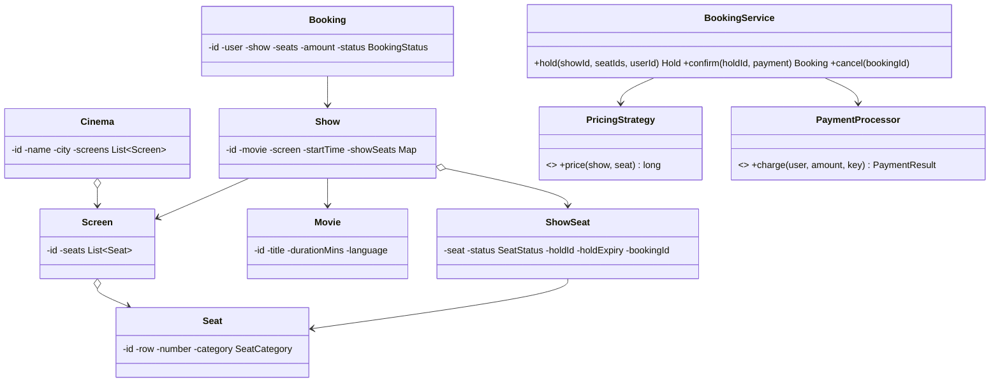

## Requirements

- Cities have **cinemas**; cinemas have **screens** with a **seat layout** (rows, seat numbers, categories like REGULAR/PREMIUM/RECLINER).
- **Movies** are scheduled as **shows** (movie, screen, start time).
- Users browse shows by city/movie/date, view the **seat map**, select seats, which are **held** for a few minutes, then pay to **book**.
- No seat may be booked twice for the same show; abandoned holds are released automatically.
- Pricing varies by seat category, day and time (and may change).

## Class diagram



**Key modelling point:** `Seat` is physical and permanent; `ShowSeat` is that seat's status **for one show**. Availability lives on `ShowSeat`.

## Key code

```java
enum SeatStatus { AVAILABLE, HELD, BOOKED }

class ShowSeat {
    private final Seat seat;
    private SeatStatus status = SeatStatus.AVAILABLE;
    private String holdId;
    private Instant holdExpiry;
    private String bookingId;

    boolean isAvailable(Instant now) {
        return status == SeatStatus.AVAILABLE
            || (status == SeatStatus.HELD && holdExpiry.isBefore(now));   // expired hold counts as free
    }
    void hold(String holdId, Instant expiry) { status = SeatStatus.HELD; this.holdId = holdId; holdExpiry = expiry; }
    void book(String bookingId) { status = SeatStatus.BOOKED; this.bookingId = bookingId; }
    void release() { status = SeatStatus.AVAILABLE; holdId = null; holdExpiry = null; }
    // getters
}

class Show {
    private final String id;
    private final Map<String, ShowSeat> seats;          // seatId → ShowSeat
    private final ReentrantLock lock = new ReentrantLock();   // per-show lock: shows don't block each other
    // ...
}

class BookingService {
    private static final Duration HOLD_TIME = Duration.ofMinutes(7);
    private final ShowRepository shows;
    private final PricingStrategy pricing;
    private final PaymentProcessor payments;
    private final Clock clock;

    public Hold hold(String showId, List<String> seatIds, String userId) {
        Show show = shows.get(showId);
        show.lock().lock();
        try {
            Instant now = clock.instant();
            List<ShowSeat> wanted = seatIds.stream().map(show::seat).toList();
            if (!wanted.stream().allMatch(s -> s.isAvailable(now)))       // all or nothing
                throw new SeatUnavailableException(seatIds);
            String holdId = UUID.randomUUID().toString();
            wanted.forEach(s -> s.hold(holdId, now.plus(HOLD_TIME)));
            long total = wanted.stream().mapToLong(s -> pricing.price(show, s.seat())).sum();
            return new Hold(holdId, showId, userId, seatIds, total, now.plus(HOLD_TIME));
        } finally {
            show.lock().unlock();
        }
    }

    public Booking confirm(Hold hold, PaymentDetails pd) {
        PaymentResult r = payments.charge(hold.userId(), hold.total(), "booking-" + hold.holdId());  // idempotent
        if (!r.success()) { release(hold); throw new PaymentFailedException(); }

        Show show = shows.get(hold.showId());
        show.lock().lock();
        try {
            Instant now = clock.instant();
            List<ShowSeat> seats = hold.seatIds().stream().map(show::seat).toList();
            boolean stillOurs = seats.stream().allMatch(s ->
                    s.status() == SeatStatus.HELD && hold.holdId().equals(s.holdId())
                    || s.isAvailable(now));                              // expired but nobody took it
            if (!stillOurs) { payments.refund(r.paymentId()); throw new HoldExpiredException(); }
            String bookingId = UUID.randomUUID().toString();
            seats.forEach(s -> s.book(bookingId));
            return new Booking(bookingId, hold.userId(), show, hold.seatIds(), hold.total(), BookingStatus.CONFIRMED);
        } finally {
            show.lock().unlock();
        }
    }
}
```

## Design decisions

- **All-or-nothing holds** under a **per-show lock**: concurrency is contained to one show; different shows proceed in parallel.
- **Lazy expiry:** an expired hold is treated as available at check time, so correctness doesn't depend on a cleanup job (a background job still tidies statuses).
- **Idempotent payment** keyed by hold ID; refund automatically if the hold was lost before confirmation.
- **Pricing strategy** for category/time-based or dynamic pricing.
- In a distributed deployment, the per-show lock becomes a database transaction with conditional updates (or a unique constraint on `(show_id, seat_id)` in bookings). See [Lab: Ticket Booking](#/l/13-design-it-yourself/ticket-booking).

## Extensions

- Cancellations with refund policies (strategy by time before show).
- Coupons/offers applied in pricing.
- Seat selection rules (no single empty seat gaps).
- Notifications (booking confirmation, reminders) via Observer/events.
