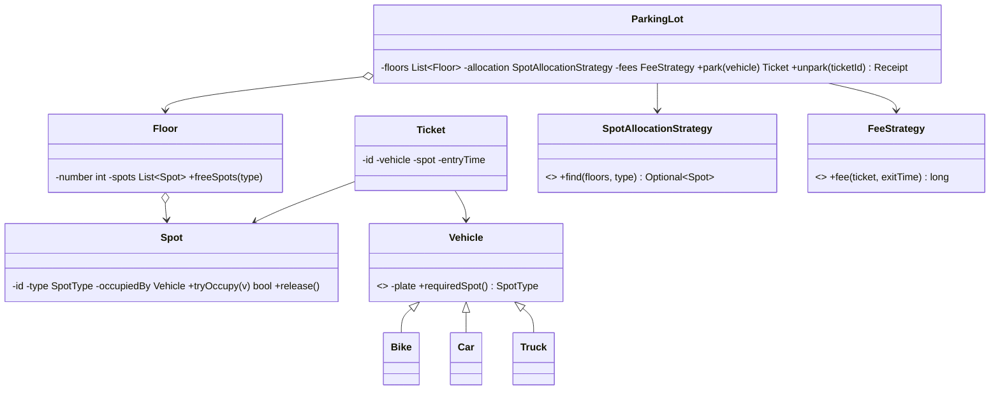

## Requirements

- A lot has multiple **floors**; each floor has **spots** of types: SMALL (bike), MEDIUM (car), LARGE (bus/truck).
- Vehicles: bike, car, truck. A vehicle parks in the smallest compatible free spot (configurable strategy).
- Multiple **entry/exit gates** operate concurrently.
- On entry, issue a **ticket**; on exit, compute the **fee** (hourly rates differ by spot type; rules may change) and accept payment.
- Show free spots per floor and type.

## Class diagram



## Key code

```java
enum SpotType { SMALL, MEDIUM, LARGE }

abstract class Vehicle {
    private final String plate;
    protected Vehicle(String plate) { this.plate = plate; }
    String plate() { return plate; }
    abstract SpotType requiredSpot();
}
class Bike  extends Vehicle { Bike(String p)  { super(p); } SpotType requiredSpot() { return SpotType.SMALL; } }
class Car   extends Vehicle { Car(String p)   { super(p); } SpotType requiredSpot() { return SpotType.MEDIUM; } }
class Truck extends Vehicle { Truck(String p) { super(p); } SpotType requiredSpot() { return SpotType.LARGE; } }

class Spot {
    private final String id;
    private final SpotType type;
    private final AtomicReference<Vehicle> occupiedBy = new AtomicReference<>();
    Spot(String id, SpotType type) { this.id = id; this.type = type; }

    boolean tryOccupy(Vehicle v) { return occupiedBy.compareAndSet(null, v); }   // atomic claim
    void release() { occupiedBy.set(null); }
    boolean isFree() { return occupiedBy.get() == null; }
    SpotType type() { return type; }
    String id() { return id; }
}

interface SpotAllocationStrategy { Optional<Spot> find(List<Floor> floors, SpotType type); }

class LowestFloorFirst implements SpotAllocationStrategy {
    public Optional<Spot> find(List<Floor> floors, SpotType type) {
        return floors.stream().flatMap(f -> f.spots().stream())
                .filter(s -> s.type() == type && s.isFree())
                .findFirst();
    }
}

interface FeeStrategy { long feeInPaise(Ticket t, Instant exit); }

class HourlyFee implements FeeStrategy {
    private final Map<SpotType, Long> ratePerHour = Map.of(
        SpotType.SMALL, 2_000L, SpotType.MEDIUM, 5_000L, SpotType.LARGE, 10_000L);
    public long feeInPaise(Ticket t, Instant exit) {
        long minutes = Duration.between(t.entryTime(), exit).toMinutes();
        long hours = Math.max(1, (minutes + 59) / 60);                 // round up, min 1 hour
        return hours * ratePerHour.get(t.spot().type());
    }
}

record Ticket(String id, Vehicle vehicle, Spot spot, Instant entryTime) { }

class ParkingLot {
    private final List<Floor> floors;
    private final SpotAllocationStrategy allocation;
    private final FeeStrategy fees;
    private final Clock clock;
    private final Map<String, Ticket> active = new ConcurrentHashMap<>();

    ParkingLot(List<Floor> floors, SpotAllocationStrategy a, FeeStrategy f, Clock clock) {
        this.floors = floors; this.allocation = a; this.fees = f; this.clock = clock;
    }

    public Ticket park(Vehicle v) {
        for (int attempt = 0; attempt < 5; attempt++) {
            Spot spot = allocation.find(floors, v.requiredSpot())
                    .orElseThrow(() -> new LotFullException(v.requiredSpot()));
            if (spot.tryOccupy(v)) {                                   // another gate may have won
                Ticket t = new Ticket(UUID.randomUUID().toString(), v, spot, clock.instant());
                active.put(t.id(), t);
                return t;
            }
        }
        throw new LotFullException(v.requiredSpot());
    }

    public Receipt unpark(String ticketId) {
        Ticket t = active.remove(ticketId);
        if (t == null) throw new IllegalArgumentException("Unknown or already used ticket");
        long amount = fees.feeInPaise(t, clock.instant());
        t.spot().release();
        return new Receipt(t.id(), amount);
    }
}
```

## Design decisions

- **Concurrency:** gates race for the same free spot. `compareAndSet` on the spot makes claiming atomic without a global lock; the loser simply looks for another spot. A ticket can be used only once (`active.remove` is atomic).
- **Open/closed:** new fee schemes (weekend rates, monthly passes) = new `FeeStrategy`; new allocation policies (nearest to gate, EV spots first) = new `SpotAllocationStrategy`.
- **Testability:** time comes from an injected `Clock`, so fee logic can be tested deterministically.
- **Money in paise** (long), not `double`.
- **Display boards** can subscribe to spot changes (Observer) to show live free counts per floor.

## Extensions to discuss

- EV spots with charging fees (new `SpotType` + fee component).
- Allowing a bike in a car spot when small spots are full (allocation strategy checks compatible larger types).
- Reservations and monthly passes.
- Multiple lots managed by one system; persistence via a `TicketRepository`.
- Payment methods via a `PaymentProcessor` interface.
