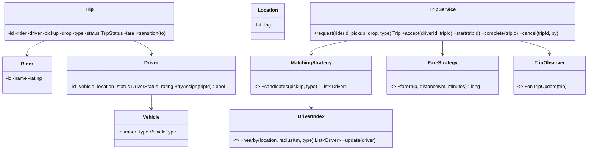

> [!REAL] Booking an Ola or Uber
> Rider requests, a driver is matched, the trip moves through states (requested, accepted, started, completed) and the fare uses a pricing strategy that can include surge.
## Requirements (LLD scope)

- **Riders** request a ride (pickup, drop, vehicle type: BIKE/AUTO/CAB).
- **Drivers** go online/offline and update location; they accept or decline offers.
- The system finds a nearby available driver of the right type and offers the trip; if declined or timed out, it offers to the next.
- **Trip lifecycle:** REQUESTED → DRIVER_ASSIGNED → DRIVER_ARRIVED → IN_PROGRESS → COMPLETED, or CANCELLED.
- **Fare** depends on vehicle type, distance, time and surge; rules change.
- Ratings for both sides after the trip.

## Class diagram



## Key code

```java
enum DriverStatus { OFFLINE, AVAILABLE, ASSIGNED, ON_TRIP }
enum TripStatus { REQUESTED, DRIVER_ASSIGNED, DRIVER_ARRIVED, IN_PROGRESS, COMPLETED, CANCELLED }

class Driver {
    private final String id;
    private final Vehicle vehicle;
    private volatile Location location;
    private final AtomicReference<DriverStatus> status = new AtomicReference<>(DriverStatus.OFFLINE);

    boolean tryAssign() { return status.compareAndSet(DriverStatus.AVAILABLE, DriverStatus.ASSIGNED); }
    void release()      { status.set(DriverStatus.AVAILABLE); }
    void startTrip()    { status.set(DriverStatus.ON_TRIP); }
    // getters
}

/** Simple grid index: cell = floor(lat / size), floor(lng / size). */
class GridDriverIndex implements DriverIndex {
    private static final double CELL = 0.01;                 // ~1 km
    private final Map<String, Set<Driver>> cells = new ConcurrentHashMap<>();
    private final Map<String, String> driverCell = new ConcurrentHashMap<>();

    public void update(Driver d) {
        String cell = key(d.location());
        String old = driverCell.put(d.id(), cell);
        if (old != null && !old.equals(cell)) cells.getOrDefault(old, Set.of()).remove(d);
        cells.computeIfAbsent(cell, k -> ConcurrentHashMap.newKeySet()).add(d);
    }

    public List<Driver> nearby(Location p, double radiusKm, VehicleType type) {
        int r = (int) Math.ceil(radiusKm);                    // cells to search in each direction
        List<Driver> out = new ArrayList<>();
        int baseLat = (int) Math.floor(p.lat() / CELL), baseLng = (int) Math.floor(p.lng() / CELL);
        for (int i = -r; i <= r; i++)
            for (int j = -r; j <= r; j++)
                for (Driver d : cells.getOrDefault((baseLat + i) + ":" + (baseLng + j), Set.of()))
                    if (d.isAvailable() && d.vehicle().type() == type) out.add(d);
        out.sort(Comparator.comparingDouble(d -> Geo.km(p, d.location())));
        return out;
    }

    private String key(Location l) { return (int) Math.floor(l.lat() / CELL) + ":" + (int) Math.floor(l.lng() / CELL); }
}

class TripService {
    private static final Duration OFFER_TIMEOUT = Duration.ofSeconds(15);
    private final MatchingStrategy matching;
    private final FareStrategy fares;
    private final OfferGateway offers;             // sends an offer, returns ACCEPTED/DECLINED/TIMEOUT

    public Trip request(Rider rider, Location pickup, Location drop, VehicleType type) {
        Trip trip = Trip.requested(rider, pickup, drop, type);
        for (Driver d : matching.candidates(pickup, type)) {
            if (!d.tryAssign()) continue;              // someone else got this driver
            OfferResult r = offers.offer(d, trip, OFFER_TIMEOUT);
            if (r == OfferResult.ACCEPTED) { trip.assign(d); return trip; }
            d.release();                               // declined / timed out → next candidate
        }
        trip.moveTo(TripStatus.CANCELLED);             // no driver found
        return trip;
    }

    public void complete(Trip trip, double distanceKm, long minutes) {
        trip.setFare(fares.fare(trip, distanceKm, minutes));
        trip.moveTo(TripStatus.COMPLETED);
        trip.driver().release();
    }
}

class StandardFare implements FareStrategy {
    private final Map<VehicleType, long[]> rates = Map.of(   // {base, perKm, perMin} in paise
        VehicleType.BIKE, new long[]{2_000, 600, 100},
        VehicleType.AUTO, new long[]{3_000, 1_000, 150},
        VehicleType.CAB,  new long[]{5_000, 1_400, 200});
    private final SurgeProvider surge;
    public long fare(Trip t, double km, long minutes) {
        long[] r = rates.get(t.type());
        long base = r[0] + Math.round(km * r[1]) + minutes * r[2];
        return Math.round(base * surge.multiplier(t.pickup()));
    }
}
```

## Design decisions

- **Atomic driver assignment** (`compareAndSet` AVAILABLE → ASSIGNED) prevents double booking under concurrent requests.
- **Spatial grid index** makes "nearby drivers" proportional to drivers in a few cells, not all drivers. At real scale, see [Design a Ride-Sharing Service](#/l/10-hld-case-studies/ride-sharing).
- **Strategies** for matching (nearest, best ETA, rating-weighted) and fares (standard, surge, subscriptions).
- **Trip state machine** with validated transitions; observers notify rider and driver apps.
- **Cancellation policy** as a strategy (free within 2 minutes, fee afterwards).

## Extensions

- Shared rides (pool): trips with multiple riders and route insertion.
- Scheduled rides.
- Driver incentives, ratings-based matching, safety features (SOS, trip sharing).
