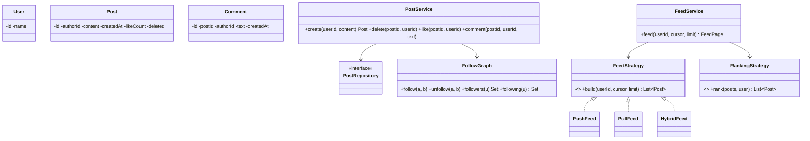

## Requirements (LLD scope)

- Users create **posts** (text, optional media), **follow/unfollow** other users, **like** and **comment** on posts.
- A user's **news feed** shows posts from people they follow, newest first (with a pluggable ranking option), paginated.
- A user's **profile** shows their own posts.
- Deleting a post removes it from feeds.

## Class diagram



## Key code

```java
record Post(long id, String authorId, String content, Instant createdAt) { }   // id is time-ordered

class FollowGraph {
    private final Map<String, Set<String>> following = new ConcurrentHashMap<>();
    private final Map<String, Set<String>> followers = new ConcurrentHashMap<>();

    void follow(String a, String b) {
        if (a.equals(b)) throw new IllegalArgumentException("Cannot follow yourself");
        following.computeIfAbsent(a, k -> ConcurrentHashMap.newKeySet()).add(b);
        followers.computeIfAbsent(b, k -> ConcurrentHashMap.newKeySet()).add(a);
    }
    void unfollow(String a, String b) {
        following.getOrDefault(a, Set.of()).remove(b);
        followers.getOrDefault(b, Set.of()).remove(a);
    }
    Set<String> following(String u) { return following.getOrDefault(u, Set.of()); }
    Set<String> followers(String u) { return followers.getOrDefault(u, Set.of()); }
}

/** Pull: merge each followee's newest posts with a heap (k-way merge). */
class PullFeed implements FeedStrategy {
    private final FollowGraph graph;
    private final PostRepository posts;   // postsByAuthor(author, beforeId, limit), newest first

    /** One author's posts (newest first) plus a cursor into them. */
    private static final class Head {
        final List<Post> posts; int i;
        Head(List<Post> posts) { this.posts = posts; }
        Post current() { return posts.get(i); }
    }

    public List<Post> build(String userId, long beforeId, int limit) {
        PriorityQueue<Head> heap = new PriorityQueue<>(
            Comparator.comparingLong((Head h) -> h.current().id()).reversed());   // newest on top
        for (String author : graph.following(userId)) {
            List<Post> recent = posts.postsByAuthor(author, beforeId, limit);
            if (!recent.isEmpty()) heap.add(new Head(recent));
        }
        List<Post> out = new ArrayList<>(limit);
        while (out.size() < limit && !heap.isEmpty()) {
            Head h = heap.poll();
            out.add(h.current());
            if (++h.i < h.posts.size()) heap.add(h);       // re-insert with its next post
        }
        return out;
    }
}

/** Push: when someone posts, prepend the post id to each follower's timeline. */
class PushFeed implements FeedStrategy, PostListener {
    private static final int MAX_TIMELINE = 800;
    private final Map<String, Deque<Long>> timelines = new ConcurrentHashMap<>();
    private final FollowGraph graph;
    private final PostRepository posts;

    public void onPostCreated(Post p) {                     // called asynchronously after create
        for (String f : graph.followers(p.authorId())) {
            Deque<Long> t = timelines.computeIfAbsent(f, k -> new ConcurrentLinkedDeque<>());
            t.addFirst(p.id());
            while (t.size() > MAX_TIMELINE) t.pollLast();
        }
    }

    public List<Post> build(String userId, long beforeId, int limit) {
        return timelines.getOrDefault(userId, new ArrayDeque<>()).stream()
                .filter(id -> id < beforeId)
                .limit(limit)
                .map(posts::get)
                .filter(p -> p != null && !p.deleted())        // deletions filtered at read time
                .toList();
    }
}
```

`HybridFeed` uses push for normal authors and pull for authors with huge follower counts, merging both at read time. The same idea as [How Instagram Keeps the Feed Instant](#/l/14-crisp-case-studies/instagram-feed).

## Cursor pagination

The client sends the last post ID it saw (`beforeId`); the next page returns posts with smaller IDs. Time-ordered IDs (Snowflake-style) make "newest first" equal to "largest ID first", and pages stay stable even as new posts arrive.

## Likes and comments

- Likes stored as a set per post (`postId → userIds`) so liking twice is idempotent; `likeCount` maintained atomically (`AtomicLong`) or computed from the set size.
- Comments in a list per post, paginated the same way.

## Design decisions

- **Feed construction as a strategy** (push, pull, hybrid), swappable without touching post creation.
- **Ranking as a separate strategy** (chronological, engagement-weighted) applied after retrieval.
- **Observer:** post creation notifies the push-feed builder and other listeners (notifications, search indexing) asynchronously.
- **Deletions** are soft deletes, filtered at read time, so timelines don't need immediate rewrites.
- **Thread-safe collections**; in production, timelines live in Redis and posts in a sharded store.

## Extensions

- Privacy (close friends, blocked users) as filters before ranking.
- Media posts with upload handling.
- Notifications for likes/comments/mentions.
- System design at scale: [Design a Photo-Sharing Service](#/l/10-hld-case-studies/photo-sharing).
