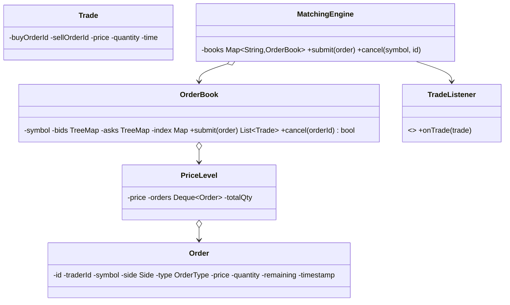

## Requirements

- Traders submit **orders** for a symbol: BUY or SELL, **LIMIT** (with a price) or **MARKET** (best available).
- Each symbol has an **order book**; incoming orders match against the opposite side using **price–time priority**: best price first, and at the same price, earliest order first.
- Partial fills are allowed; unfilled limit quantity rests in the book. Market orders don't rest.
- Traders can **cancel** resting orders.
- Every match produces a **trade** (price, quantity, buyer, seller), published to subscribers.

## Class diagram



## Data structures

- **Bids** (buy orders): `TreeMap<price, PriceLevel>` sorted **descending**, so the highest bid is first.
- **Asks** (sell orders): `TreeMap<price, PriceLevel>` sorted **ascending**, so the lowest ask is first.
- Each **price level** holds a FIFO queue of orders: time priority.
- An **index** `orderId → order` for O(1)-ish cancellation lookup.

Prices are stored as integers (ticks/paise) to avoid floating-point errors.

## Matching code

```java
enum Side { BUY, SELL }
enum OrderType { LIMIT, MARKET }

final class Order {
    final String id, traderId; final Side side; final OrderType type;
    final long price;                 // in paise; ignored for MARKET
    long remaining;
    final long seq;                   // arrival sequence for time priority
    // constructor...
}

record Trade(String buyOrderId, String sellOrderId, long price, long qty, long seq) { }

class OrderBook {
    private final NavigableMap<Long, Deque<Order>> bids = new TreeMap<>(Comparator.reverseOrder());
    private final NavigableMap<Long, Deque<Order>> asks = new TreeMap<>();
    private final Map<String, Order> live = new HashMap<>();
    private long tradeSeq;

    /** Single-threaded per book: called only from this symbol's matching thread. */
    List<Trade> submit(Order in) {
        List<Trade> trades = new ArrayList<>();
        NavigableMap<Long, Deque<Order>> opposite = in.side == Side.BUY ? asks : bids;

        while (in.remaining > 0 && !opposite.isEmpty()) {
            Map.Entry<Long, Deque<Order>> best = opposite.firstEntry();
            long bestPrice = best.getKey();
            if (in.type == OrderType.LIMIT && !crosses(in, bestPrice)) break;   // no acceptable price

            Deque<Order> level = best.getValue();
            Order resting = level.peekFirst();                                  // earliest at this price
            long qty = Math.min(in.remaining, resting.remaining);
            trades.add(in.side == Side.BUY
                    ? new Trade(in.id, resting.id, bestPrice, qty, ++tradeSeq)  // trade at resting price
                    : new Trade(resting.id, in.id, bestPrice, qty, ++tradeSeq));
            in.remaining -= qty;
            resting.remaining -= qty;

            if (resting.remaining == 0) { level.pollFirst(); live.remove(resting.id); }
            if (level.isEmpty()) opposite.pollFirstEntry();
        }

        if (in.remaining > 0 && in.type == OrderType.LIMIT) {                   // rest the remainder
            (in.side == Side.BUY ? bids : asks)
                .computeIfAbsent(in.price, p -> new ArrayDeque<>()).addLast(in);
            live.put(in.id, in);
        }
        return trades;                                                          // MARKET remainder is cancelled
    }

    private boolean crosses(Order in, long bestOpposite) {
        return in.side == Side.BUY ? in.price >= bestOpposite : in.price <= bestOpposite;
    }

    boolean cancel(String orderId) {
        Order o = live.remove(orderId);
        if (o == null) return false;
        NavigableMap<Long, Deque<Order>> side = o.side == Side.BUY ? bids : asks;
        Deque<Order> level = side.get(o.price);
        level.remove(o);                                  // O(level size); use a linked map for O(1)
        if (level.isEmpty()) side.remove(o.price);
        return true;
    }
}
```

### Worked example

Asks: 101 × 50 (A1), 102 × 100 (A2). A BUY LIMIT 102 × 120 arrives:
1. Match 50 @ 101 with A1 (best price first). A1 is filled; the level is removed.
2. Match 70 @ 102 with A2. A2 has 30 left.
3. The buy is fully filled. Trades: (50 @ 101), (70 @ 102).

## Concurrency design

- **One thread per symbol (or per shard of symbols)** owns that order book: no locks inside matching, fully deterministic ordering. Incoming orders for a symbol go through a queue (e.g. a ring buffer) to its thread.
- Different symbols match in parallel on different threads/cores.
- Trades and book updates are published asynchronously to listeners (market data, clearing, trader notifications): Observer.
- **Determinism and recovery:** log every accepted input order in sequence; replaying the log rebuilds the book exactly.

## Design decisions

- Price–time priority with `TreeMap` (best price) + FIFO deques (time).
- Integer prices; trades execute at the **resting** order's price.
- Single-writer per book for speed and determinism.
- Validation and **pre-trade risk checks** (balance, limits, price bands) happen **before** the order reaches the engine.

## Extensions

- Order types: IOC (immediate-or-cancel), FOK (fill-or-kill), stop orders, iceberg orders.
- Modify order (usually cancel + new, losing time priority if price/qty increases).
- Circuit breakers that halt matching on extreme moves.
- Level-2 market data (aggregated quantities per price).
