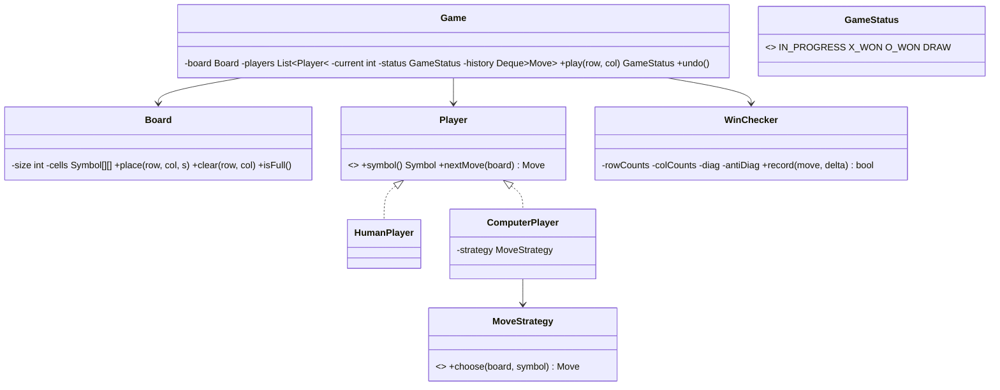

## Requirements

- Two players (human or computer) take turns placing their symbol (X or O) on an **N × N** board (default 3).
- A player wins with N in a row: row, column or either diagonal. Full board with no winner = draw.
- Reject invalid moves (occupied cell, out of bounds, wrong player's turn, game already over).
- Support an **undo** of the last move (nice to have) and a pluggable **computer strategy**.

## Class diagram



## O(1) win detection

Scanning the whole board after each move is O(N²). Instead, keep running counters: +1 for X, −1 for O, per row, per column and for both diagonals. A player wins when any counter reaches ±N.

```java
enum Symbol { X(1), O(-1); final int delta; Symbol(int d) { delta = d; } }

record Move(int row, int col, Symbol symbol) { }

class WinChecker {
    private final int n;
    private final int[] rows, cols;
    private int diag, antiDiag;

    WinChecker(int n) { this.n = n; rows = new int[n]; cols = new int[n]; }

    /** Apply (sign = +1) or undo (sign = -1) a move. Returns true if this move wins. */
    boolean record(Move m, int sign) {
        int d = m.symbol().delta * sign;
        rows[m.row()] += d;
        cols[m.col()] += d;
        if (m.row() == m.col()) diag += d;
        if (m.row() + m.col() == n - 1) antiDiag += d;
        int target = n * m.symbol().delta;
        return sign > 0 && (rows[m.row()] == target || cols[m.col()] == target
                || diag == target || antiDiag == target);
    }
}
```

## Game logic

```java
enum GameStatus { IN_PROGRESS, X_WON, O_WON, DRAW }

class Game {
    private final Board board;
    private final List<Player> players;
    private final WinChecker winChecker;
    private final Deque<Move> history = new ArrayDeque<>();
    private int current = 0;
    private GameStatus status = GameStatus.IN_PROGRESS;

    Game(int n, Player first, Player second) {
        board = new Board(n);
        players = List.of(first, second);
        winChecker = new WinChecker(n);
    }

    public GameStatus play(int row, int col) {
        if (status != GameStatus.IN_PROGRESS) throw new IllegalStateException("Game over: " + status);
        Symbol s = players.get(current).symbol();
        board.place(row, col, s);                       // throws if out of bounds or occupied
        Move move = new Move(row, col, s);
        history.push(move);

        if (winChecker.record(move, +1)) status = (s == Symbol.X) ? GameStatus.X_WON : GameStatus.O_WON;
        else if (board.isFull()) status = GameStatus.DRAW;
        else current = 1 - current;
        return status;
    }

    public void undo() {
        if (history.isEmpty()) throw new IllegalStateException("Nothing to undo");
        Move last = history.pop();
        board.clear(last.row(), last.col());
        winChecker.record(last, -1);
        status = GameStatus.IN_PROGRESS;
        current = players.get(0).symbol() == last.symbol() ? 0 : 1;   // it's that player's turn again
    }

    public void playComputerTurnIfNeeded() {
        Player p = players.get(current);
        if (p instanceof ComputerPlayer cp && status == GameStatus.IN_PROGRESS) {
            Move m = cp.nextMove(board);
            play(m.row(), m.col());
        }
    }
}

class Board {
    private final Symbol[][] cells;
    private int filled;
    Board(int n) { cells = new Symbol[n][n]; }
    void place(int r, int c, Symbol s) {
        if (r < 0 || c < 0 || r >= cells.length || c >= cells.length) throw new IllegalArgumentException("Out of bounds");
        if (cells[r][c] != null) throw new IllegalArgumentException("Cell occupied");
        cells[r][c] = s; filled++;
    }
    void clear(int r, int c) { cells[r][c] = null; filled--; }
    boolean isFull() { return filled == cells.length * cells.length; }
}
```

## Computer strategies (Strategy pattern)

- `RandomStrategy`: any empty cell.
- `RuleBasedStrategy`: win if possible, else block the opponent's win, else take centre, corners, sides.
- `MinimaxStrategy`: perfect play for 3×3 by exploring the game tree (with alpha–beta pruning); too slow for large N without depth limits and heuristics.

## Design decisions

- **Separation of concerns:** `Board` stores cells, `WinChecker` decides wins, `Game` enforces turns and status, `Player` decides moves.
- **O(1) win checks** with counters; undo simply reverses the counter update.
- **Command-like history** (a stack of moves) gives undo/replay for free.
- **Strategy** for AI difficulty levels; **N × N** generalises naturally.

## Extensions

- K-in-a-row on larger boards (Gomoku-style): counters no longer suffice; check the four directions from the last move in O(K).
- Multiplayer over the network: the `Game` becomes server-side; clients send moves; the server validates turn order.
- Persisting and replaying games from the move history.
