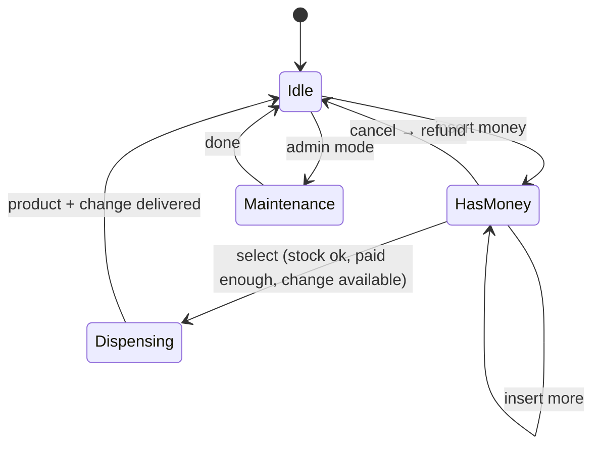
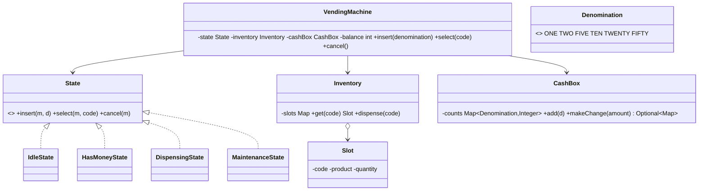

> [!REAL] The snack machine at the railway station
> Insert coins, choose an item, get it and your change, or a refund if it's out of stock. What each button does depends on the machine's current state: a textbook State pattern.
## Requirements

- The machine holds **products** in slots (code, price, quantity).
- Users insert **coins/notes** (₹1, ₹2, ₹5, ₹10, ₹20, ₹50), select a product, receive it and their **change**.
- Users can **cancel** and get a full refund before dispensing.
- Reject selection if out of stock or insufficient money; refuse to sell if exact change can't be returned.
- Admin can restock products and refill change.
- Only one transaction at a time.

## State diagram first



## Class diagram



## Key code

```java
enum Denomination {
    ONE(1), TWO(2), FIVE(5), TEN(10), TWENTY(20), FIFTY(50);
    final int value;
    Denomination(int v) { value = v; }
}

class CashBox {
    private final EnumMap<Denomination, Integer> counts = new EnumMap<>(Denomination.class);

    void add(Denomination d) { counts.merge(d, 1, Integer::sum); }

    // Greedy works for this coin system (canonical); compute first, commit only if possible.
    Optional<Map<Denomination, Integer>> makeChange(int amount) {
        Map<Denomination, Integer> result = new EnumMap<>(Denomination.class);
        List<Denomination> desc = new ArrayList<>(List.of(Denomination.values()));
        Collections.reverse(desc);
        for (Denomination d : desc) {
            int use = Math.min(amount / d.value, counts.getOrDefault(d, 0));
            if (use > 0) { result.put(d, use); amount -= use * d.value; }
        }
        return amount == 0 ? Optional.of(result) : Optional.empty();
    }

    void remove(Map<Denomination, Integer> coins) { coins.forEach((d, n) -> counts.merge(d, -n, Integer::sum)); }
}

interface State {
    default void insert(VendingMachine m, Denomination d) { throw new IllegalStateException("Not accepting money now"); }
    default void select(VendingMachine m, String code)   { throw new IllegalStateException("Insert money first"); }
    default void cancel(VendingMachine m)                { throw new IllegalStateException("Nothing to cancel"); }
}

class IdleState implements State {
    public void insert(VendingMachine m, Denomination d) { m.acceptMoney(d); m.setState(new HasMoneyState()); }
}

class HasMoneyState implements State {
    public void insert(VendingMachine m, Denomination d) { m.acceptMoney(d); }

    public void select(VendingMachine m, String code) {
        Slot slot = m.inventory().get(code);
        if (slot == null || slot.quantity() == 0) throw new IllegalStateException("Sold out");
        int price = slot.product().price();
        if (m.balance() < price) throw new IllegalStateException("Insert ₹" + (price - m.balance()) + " more");

        Map<Denomination, Integer> change = m.cashBox().makeChange(m.balance() - price)
                .orElseThrow(() -> new IllegalStateException("Exact change only"));

        m.setState(new DispensingState());
        m.inventory().dispense(code);
        m.cashBox().remove(change);
        m.deliver(slot.product(), change);
        m.resetBalance();
        m.setState(new IdleState());
    }

    public void cancel(VendingMachine m) { m.refundAll(); m.setState(new IdleState()); }
}

class DispensingState implements State { }      // rejects everything while dispensing

class VendingMachine {
    private State state = new IdleState();
    private final Inventory inventory;
    private final CashBox cashBox;
    private int balance;
    private final List<Denomination> insertedThisTxn = new ArrayList<>();

    public synchronized void insert(Denomination d) { state.insert(this, d); }   // one user at a time
    public synchronized void select(String code)    { state.select(this, code); }
    public synchronized void cancel()               { state.cancel(this); }

    void acceptMoney(Denomination d) { cashBox.add(d); insertedThisTxn.add(d); balance += d.value; }
    void refundAll() { /* return insertedThisTxn coins */ insertedThisTxn.clear(); balance = 0; }
    void resetBalance() { insertedThisTxn.clear(); balance = 0; }
    // getters, setState, deliver(...)
}
```

## Design decisions

- **State pattern** removes `if (state == ...)` from every method and makes invalid actions impossible by default. See [State](#/l/15-design-patterns/state).
- **Change is computed before committing** anything; if it can't be made, the sale is refused and nothing changes.
- **Inserted money is tracked per transaction** so cancel refunds the exact coins.
- **`synchronized`** public methods: the machine serves one user at a time.
- **Integer rupee amounts**, not floating point.
- Greedy change works for canonical coin systems like ₹1/2/5/10/20/50; for arbitrary denominations, use dynamic programming.

## Extensions

- Card/UPI payments via a `PaymentMethod` strategy.
- Maintenance state for restocking (admin-authenticated).
- Low-stock and low-change alerts (Observer to a monitoring service).
- Multiple product dispensing per transaction; promotions via a pricing strategy.
