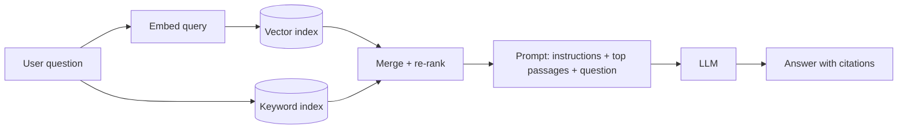

More and more design interviews include a system built around machine learning or large language models (LLMs): a support chatbot, semantic search, recommendations, document Q&A. You don't need to be an ML researcher, but you do need the vocabulary and an idea of what each piece costs. Here are the terms in plain language.

## Models and training

| Term | Plain meaning |
|---|---|
| **Model** | A function learned from data that maps inputs to outputs (text → text, image → label). |
| **Training** | Adjusting a model's parameters on lots of data. Expensive, done offline. |
| **Parameters / weights** | The learned numbers inside a model. More parameters usually means more capable and more expensive to run. |
| **Inference** | Using a trained model to produce an output. This is what your product does at request time. |
| **LLM** | Large language model: predicts the next token of text; can follow instructions, summarise, write code, reason. |
| **Foundation model** | A large, general model trained on broad data, adapted to many tasks. |
| **Fine-tuning** | Further training a model on your own examples to specialise its behaviour or style. |
| **Distillation** | Training a smaller model to imitate a larger one: cheaper and faster, somewhat less capable. |
| **Quantisation** | Storing weights with fewer bits (e.g. 8 or 4) to cut memory and speed up inference, with small quality loss. |

## Working with LLMs

| Term | Plain meaning |
|---|---|
| **Token** | A chunk of text (≈ ¾ of an English word). Models read and write tokens; pricing and limits are per token. |
| **Context window** | The maximum tokens a model can consider at once (prompt + documents + conversation + output). |
| **Prompt** | The input instructions and content you give the model. |
| **System prompt** | Standing instructions that set the model's role and rules for a conversation. |
| **Temperature** | Randomness of output: low = consistent and focused, high = varied and creative. |
| **Hallucination** | A confident but false output. Reduced (not eliminated) by grounding the model in retrieved facts. |
| **Streaming** | Sending output tokens to the user as they're generated, so responses feel fast. |
| **Time to first token (TTFT)** | Latency until the first token appears. Key UX metric for chat. |
| **Tool use / function calling** | The model outputs a structured request to call your function (search, database, API); you run it and return the result. |
| **Agent** | A loop in which a model plans, calls tools, observes results and continues until a task is done. |
| **Structured output** | Asking the model to answer in a defined schema (JSON), so code can parse it reliably. |

## Retrieval and embeddings

| Term | Plain meaning |
|---|---|
| **Embedding** | A vector of numbers representing meaning. Similar texts get nearby vectors. |
| **Vector database / index** | Stores embeddings and finds the nearest ones fast (approximate nearest neighbour, e.g. HNSW). |
| **Semantic search** | Searching by meaning ("refund policy for damaged items") rather than exact keywords. |
| **Hybrid search** | Combining keyword (BM25) and semantic search, usually better than either alone. |
| **Chunking** | Splitting documents into passages before embedding, so retrieval returns focused pieces. |
| **RAG** (retrieval-augmented generation) | Retrieve relevant passages for a question, put them in the prompt, and have the model answer from them, with citations. |
| **Re-ranking** | A second, more accurate model reorders the retrieved passages before they go to the LLM. |

## Quality, safety and operations

| Term | Plain meaning |
|---|---|
| **Evaluation (evals)** | Test sets and metrics that measure whether outputs are correct, grounded and safe. Run them before every change. |
| **Guardrails** | Checks on inputs and outputs: block unsafe content, enforce formats, redact personal data. |
| **Prompt injection** | Malicious instructions hidden in user input or retrieved documents that try to override your rules. Treat retrieved content as data, not instructions. |
| **Grounding** | Making the model base answers on supplied sources rather than memory. |
| **Model gateway / router** | A service in front of one or more model providers: routing, retries, rate limits, caching, cost tracking. |
| **Semantic cache** | Reusing a previous answer when a new question is similar enough in embedding space. |
| **Batching (inference)** | Grouping requests on a GPU to raise throughput, at some latency cost. |
| **GPU / accelerator** | Hardware that runs models efficiently; scarce and expensive, so capacity planning matters. |
| **Drift** | Real-world inputs changing over time so model quality degrades; detected by monitoring and evals. |

> [!INTERVIEW] Translate to system design
> "Retrieval is a search problem (indexes, freshness, access control); generation is an expensive, slow, non-deterministic dependency (timeouts, streaming, caching, fallbacks, cost limits); quality is a testing problem (evals). Framing it that way lets you apply everything else in this course."

## Key takeaways

- Tokens, context windows, latency (TTFT) and cost drive LLM system design.
- Embeddings + vector indexes enable semantic search; RAG grounds answers in your data.
- Tool use and agents let models act through your APIs, which calls for careful permissions.
- Evals, guardrails and prompt-injection defences are part of the architecture, not afterthoughts.
