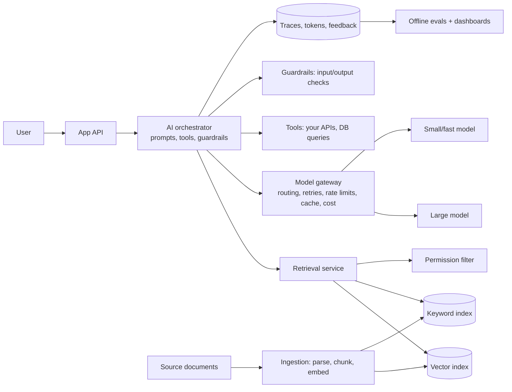

Adding an LLM to a product changes the architecture in ways that catch traditional backend engineers out. The core service is **slow, expensive, non-deterministic and capacity-limited**, and its correctness can only be measured statistically. This lesson compares the two worlds and shows a reference architecture.

## What changes

| Aspect | Traditional service | LLM-powered feature |
|---|---|---|
| Output | Deterministic for the same input | Varies; can be wrong confidently |
| Latency | Milliseconds | Seconds (generation is token by token) |
| Cost per request | Fractions of a paisa | Can be orders of magnitude higher; scales with tokens |
| Capacity | Add CPU instances | GPUs/provider rate limits (tokens per minute) |
| Testing | Unit tests with exact assertions | Evals: datasets, graders, scores, regressions |
| Failure modes | Errors, timeouts | Plus hallucinations, refusals, off-policy output, prompt injection |
| Data access | Queries with explicit permissions | Retrieval must also enforce permissions before anything enters the prompt |
| Versioning | Code versions | Code + prompt + model version + retrieval index version |
| Observability | Metrics, logs, traces | Plus token usage, cost, quality scores, user feedback |

## A reference architecture

### Components
- **Ingestion pipeline:** parses documents, splits them into chunks, computes embeddings and writes them to vector and keyword indexes, with metadata (source, permissions, timestamp). Runs on change events, like any indexing pipeline.
- **Retrieval service:** hybrid search, permission filtering (only content the user may see), re-ranking.
- **Orchestrator:** builds prompts from templates, calls tools, applies guardrails, manages conversation state and streaming.
- **Model gateway:** one place for provider keys, routing (cheap model for easy tasks, strong model for hard ones), retries and fallbacks, rate-limit handling, caching, and per-team cost accounting.
- **Observability and evals:** every request traced (prompt version, retrieved chunks, model, tokens, latency, cost, user feedback); offline evals gate prompt or model changes.

## Design techniques that carry over, and new ones

### Latency
- **Stream tokens** to the user (SSE/WebSocket) so the first words appear in under a second.
- Run retrieval and other preparation **in parallel**.
- Use **smaller models** for classification/routing and reserve large ones for generation.
- **Cache:** exact-match cache for repeated prompts; **semantic cache** for similar questions (careful with personalised or time-sensitive answers); **prompt caching** of long shared prefixes where providers support it.
- **Async** for long tasks: accept the job, process in the background, notify when done.

### Reliability
- Timeouts and retries with backoff on provider calls; **fallback models** or providers.
- **Graceful degradation:** if generation fails, return search results without a summary.
- **Structured outputs** validated against a schema; retry or repair on invalid output.

### Cost control
- Token budgets per request and per user; trim context to what's relevant.
- Route by difficulty; batch offline workloads.
- Track cost per feature and per tenant like any other resource.

### Quality and safety
- **Ground** answers in retrieved sources and show citations.
- **Evals** before shipping a prompt/model change, just as tests gate code.
- **Guardrails** on input (abuse, PII) and output (policy, format, leakage).
- **Prompt-injection defence:** retrieved documents and tool outputs are data; the model shouldn't follow instructions found in them; tools get least-privilege permissions; risky actions need confirmation.
- **Access control at retrieval time**, never "the model will decide what the user can see".

### Data and privacy
- Decide what user data may be sent to external providers; redact or use self-hosted models when required.
- Retention policies for prompts and outputs; audit logs.

> [!INTERVIEW] Design a "chat with your company's documents" feature in one breath
> "Documents are ingested on change: parsed, chunked, embedded and indexed with ACL metadata. A question triggers hybrid retrieval filtered by the user's permissions, then re-ranking; the orchestrator builds a grounded prompt with the top passages and streams the model's answer with citations through a model gateway that handles routing, retries, caching and cost. Every request is traced, and prompt or model changes must pass an eval suite first."

## Key takeaways

- LLM calls are slow, costly, capacity-limited and non-deterministic; design around that.
- Add ingestion/retrieval, an orchestrator, a model gateway, guardrails and evals to the usual architecture.
- Reuse classic techniques (streaming, caching, async, fallbacks, rate limits, observability).
- Enforce permissions in retrieval and treat retrieved text as untrusted data.
