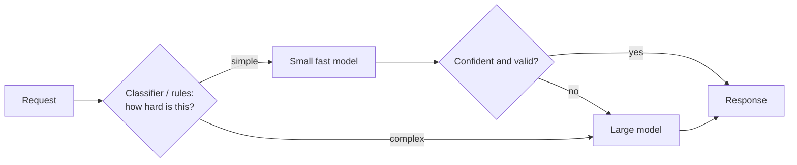

"Which model should we use?" is a system design question: it trades quality against latency, cost, privacy and operational effort. This lesson gives you a way to choose and to serve models sensibly.

## Kinds of models you might use

| Model type | Typical tasks |
|---|---|
| **Large general LLMs** | Open-ended reasoning, writing, coding, complex multi-step tasks, agents |
| **Small/fast LLMs** | Classification, extraction, routing, simple summaries, high-volume tasks |
| **Embedding models** | Semantic search, clustering, deduplication, recommendations |
| **Re-rankers** | Reordering retrieved passages for relevance |
| **Classic ML models** (gradient boosting, logistic regression) | Tabular predictions: fraud scores, churn, pricing, ranking features |
| **Speech, vision, multimodal models** | Transcription, image understanding, document parsing |

Many problems don't need an LLM at all. A rules engine or a small classifier is cheaper, faster and easier to test. Use the simplest model that meets the quality bar.

## Selection criteria

1. **Quality on *your* task.** Measure with an eval set built from real examples (with expected answers or grading rubrics). Public benchmarks are only a starting point.
2. **Latency.** Time to first token and total generation time at your expected output length.
3. **Cost.** Price per input/output token × expected volume; include retries and long contexts.
4. **Context window** large enough for your prompts and retrieved content.
5. **Capabilities:** tool calling, structured output, multimodal input, languages.
6. **Privacy and compliance:** where data is processed, retention, data-residency requirements.
7. **Operational control:** hosted API (no infrastructure, provider limits) vs self-hosting (control, GPUs to manage).

## Hosted API vs self-hosted

| | Hosted model API | Self-hosted (open-weight models) |
|---|---|---|
| Setup | Minutes | GPUs, serving stack, scaling, upgrades |
| Capability | Typically the most capable models | Good and improving; smaller models practical |
| Cost profile | Per token; no idle cost | Fixed GPU cost; cheaper at high, steady volume |
| Data control | Provider's policies and regions | Full control |
| Scaling | Provider rate limits | Your GPU capacity |
| Customisation | Prompting, sometimes fine-tuning | Full fine-tuning, quantisation, custom serving |

A common pattern: hosted frontier models for complex tasks, plus self-hosted or cheaper hosted small models for high-volume simple tasks.

## Routing and cascades

Don't send every request to the most expensive model.

- **Routing:** classify requests by difficulty or type and pick the model.
- **Cascade:** try the cheap model first; escalate if output fails validation or confidence checks.
- **Specialisation:** different models for embedding, re-ranking, extraction and generation.

> [!REAL] Junior doctor first, specialist if needed
> A clinic's junior doctor handles colds and routine cases; complex ones go to the specialist. A small, cheap model handles easy requests and escalates hard ones to the large model.

## Serving self-hosted models

- **Inference servers** batch requests dynamically on GPUs to raise throughput (continuous batching), manage the key–value cache for long contexts, and stream tokens.
- **Quantisation** (8-bit/4-bit) fits bigger models on fewer GPUs at a small quality cost.
- **Autoscaling** on queue depth/tokens per second; GPUs take time to start, so keep warm capacity and scale ahead of known peaks.
- **Placement:** keep models close to the services that call them; GPU regions may be limited.
- **Model registry and versioning:** know exactly which model version served which request; roll out new versions with canaries and evals, just like code.

## Fine-tuning vs prompting vs RAG

| Need | Usually best |
|---|---|
| Answers must use your private, changing knowledge | **RAG** (retrieve fresh documents each time) |
| Consistent format, tone or domain-specific behaviour | Prompting first; **fine-tuning** if prompts aren't enough |
| Cheaper/faster at scale for a narrow task | **Fine-tune or distil a smaller model** |
| New facts every day | RAG, not fine-tuning (retraining is slow) |

Try them in that order of effort: better prompts → RAG → fine-tuning.

> [!REAL] Instructions, a reference book or training
> Prompting is giving a new employee clear instructions. RAG is handing them the company handbook to look things up. Fine-tuning is sending them on a training course. Try them in that order.

## Measuring in production

- Quality: online feedback (thumbs up/down, edits, task success), periodic human review, automated graders on samples.
- Latency: TTFT and total time percentiles per model.
- Cost: tokens and spend per feature, per tenant, per model.
- Safety: guardrail trigger rates, flagged outputs.
- Regressions: rerun evals on every model or prompt change; A/B test significant changes.

> [!INTERVIEW] A model-choice answer
> "For ticket triage, a small model classifies and extracts fields (cheap, fast, high volume), escalating to a large model only when its output fails validation. Answers to customers use a large hosted model with RAG over the help centre, streamed for low perceived latency. Embeddings use a dedicated embedding model. Each choice was validated on our own eval set, and the gateway logs tokens and cost per feature so we can re-route if costs drift."

## Key takeaways

- Choose models by measured quality on your task, then latency, cost, privacy and operations.
- Use the smallest adequate model; route or cascade to larger ones only when needed.
- Hosted APIs are fastest to adopt; self-hosting gives control and can be cheaper at steady high volume.
- Prefer prompting → RAG → fine-tuning, and gate every change with evals.
